# Animations (`animations/`)

Everyday motions for human characters: 20 clips at 24 fps. Every file is **CC0**: they come from Quaternius' [Universal Animation Library 1 and 2](https://quaternius.com/packs/universalanimationlibrary.html), Standard (free) version. No Mixamo files are used.

- **Skeleton:** all clips share Quaternius' universal 65-bone humanoid rig, the UE5-mannequin naming (`root`, `pelvis`, `spine_01-03`, `neck_01`, `Head`, `clavicle_l/r`, `upperarm`, `lowerarm`, `hand`, fingers, `thigh`, `calf`, `foot`, `ball`).
  - **Matches:** Quaternius' Universal Base Characters (also CC0).
  - **Doesn't match:** the Rocketbox characters (`Bip01`) or the MPFB modular characters (`game_engine` rig). Those need retargeting by bone name.
- **No root motion:** clips play in place, so the game moves the character itself.
- **Files:**
  - `<Clip>.glb`: skeleton plus that one clip, no mesh.
  - `animations_all.glb`: the Quaternius mannequin plus every clip, for testing in three.js (`gltf.animations`).
  - `mannequin.glb`: the mannequin alone.
- **Previews:** `previews/<Clip>.png` shows 5 evenly spaced frames from the front-left.
- **Seated clips** (`Sit_*`, `Car_Drive_Loop`) expect a seat about 0.45 m high, with the hips about 0.30 m behind the feet; the pelvis sits at about 0.54 m.
- **`Sleep_Loop` and the end of `Lie_Down`:** lying on the back, head toward +Z in glTF (the character's back on the floor).
- **Built clips:** some clips were built in Blender from library clips, with arm IK and added motion. Their source column says what was combined. They remain CC0.

| File | What it shows | Length | Loops | Source | Licence | Preview |
|---|---|---|---|---|---|---|
| `Idle_Loop.glb` | standing idle | 2.50 s (61 frames) | yes | UAL1 `Idle_Loop` | CC0 | 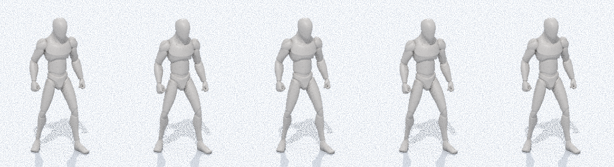 |
| `Walk_Loop.glb` | walk, in place (no root motion) | 1.33 s (33 frames) | yes | UAL1 `Walk_Loop` | CC0 | 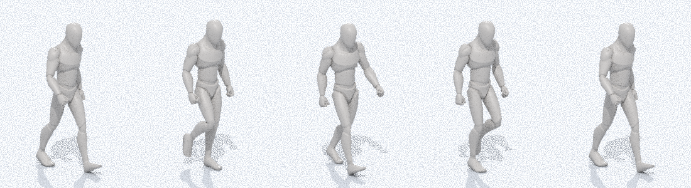 |
| `Get_Up.glb` | from lying on the floor or a bed to standing | 1.53 s (38 frames) | no | UAL2 `LayToIdle` | CC0 | 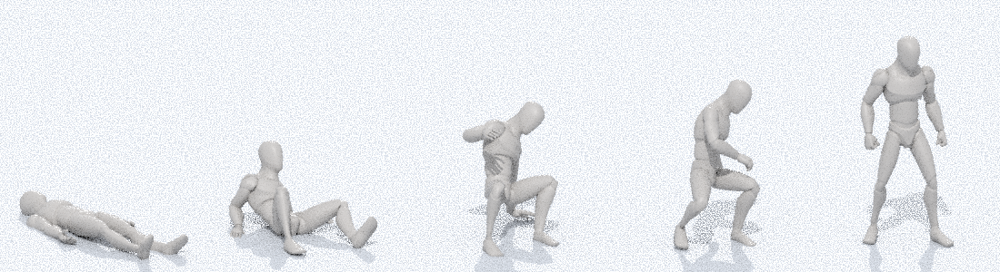 |
| `Sit_Down.glb` | standing to seated (chair, toilet, car seat) | 1.30 s (32 frames) | no | UAL1 `Sitting_Enter` | CC0 | 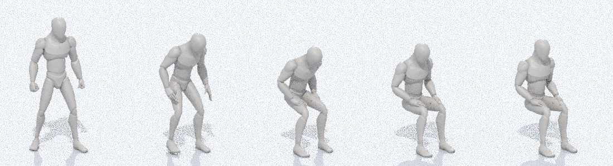 |
| `Sit_Idle_Loop.glb` | seated idle (table, toilet, waiting) | 1.67 s (41 frames) | yes | UAL1 `Sitting_Idle_Loop` | CC0 | 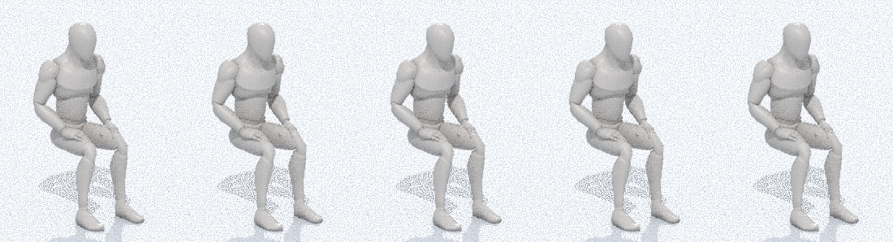 |
| `Sit_Talk_Loop.glb` | seated, talking with gestures | 2.93 s (71 frames) | yes | UAL1 `Sitting_Talking_Loop` | CC0 | 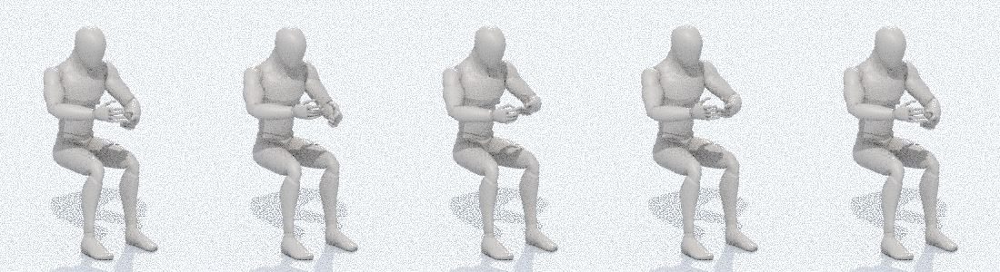 |
| `Stand_Up.glb` | seated to standing | 1.03 s (26 frames) | no | UAL1 `Sitting_Exit` | CC0 | 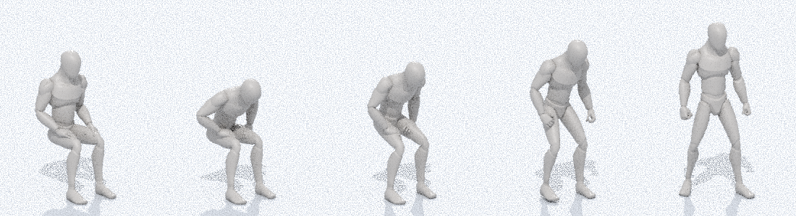 |
| `Eat_Standing.glb` | eat or drink: hand to mouth and back, standing | 1.33 s (33 frames) | no | UAL2 `Consume` | CC0 | 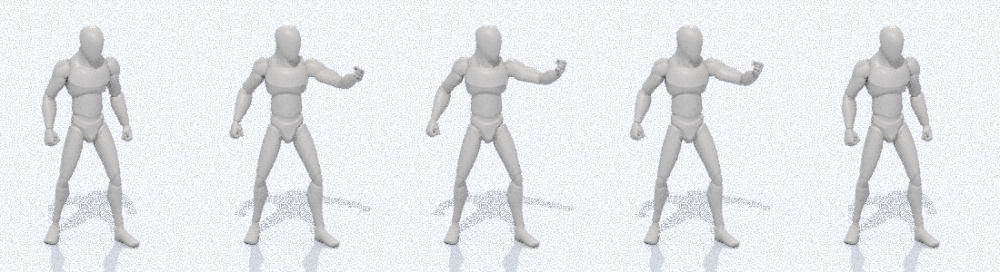 |
| `Phone_Talk_Loop.glb` | standing, phone held to the ear, talking | 2.93 s (71 frames) | yes | UAL2 `Idle_TalkingPhone_Loop` | CC0 | 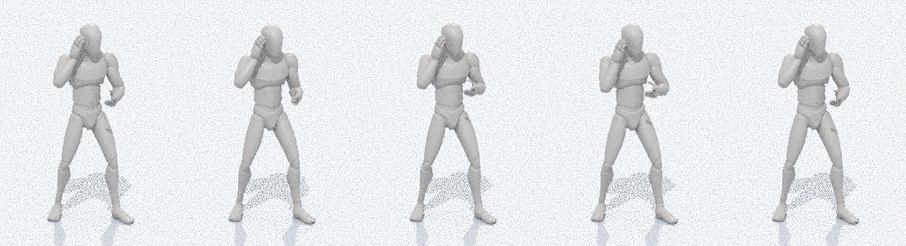 |
| `Carry_Walk_Loop.glb` | walking while carrying a box in both arms | 2.00 s (49 frames) | yes | UAL2 `Walk_Carry_Loop` | CC0 | 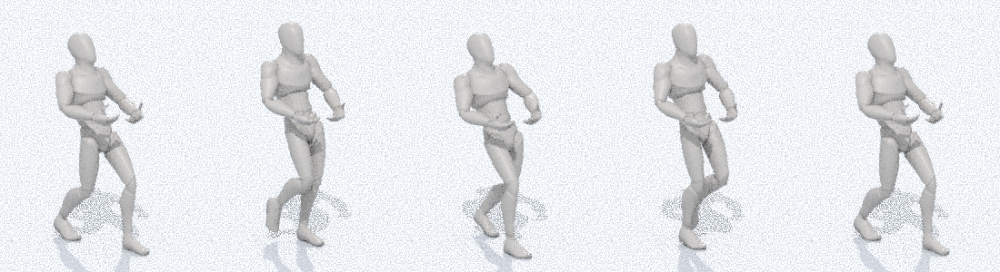 |
| `Pick_Up.glb` | reach down and pick something up from a table | 0.83 s (21 frames) | no | UAL1 `PickUp_Table` | CC0 | 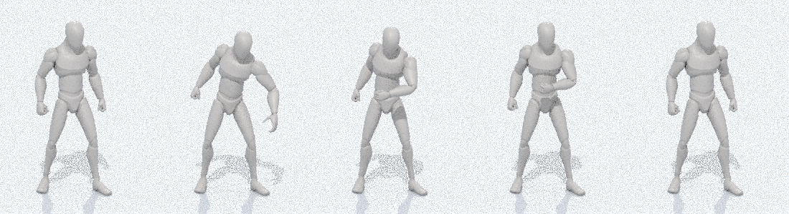 |
| `Car_Drive_Loop.glb` | seated, both hands on a steering wheel | 1.67 s (41 frames) | yes | UAL1 `Driving_Loop` | CC0 | 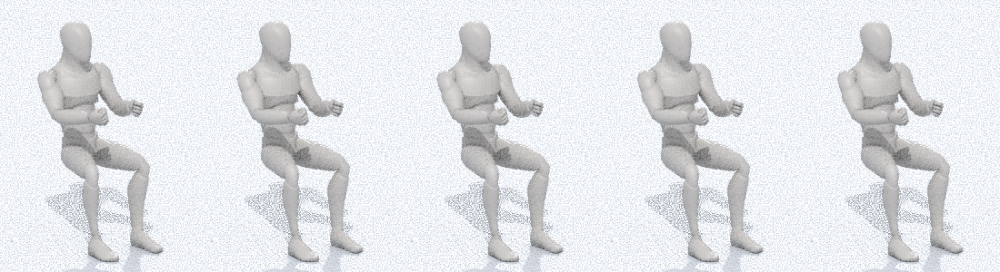 |
| `Interact.glb` | reach out and press or use something (door, switch, counter) | 2.00 s (49 frames) | no | UAL1 `Interact` | CC0 | 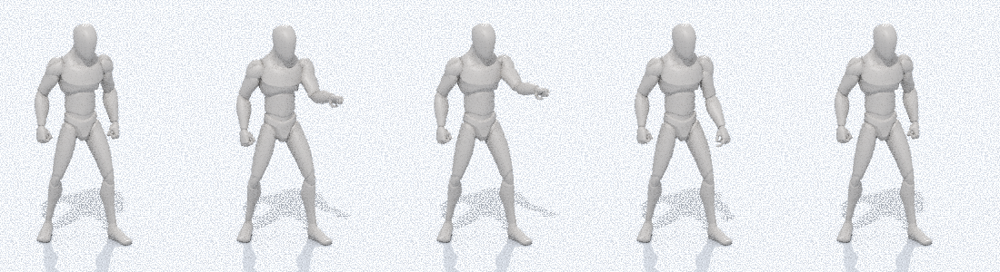 |
| `Lie_Down.glb` | from standing down to lying on the back (end pose = Sleep_Loop) | 1.54 s (38 frames) | no | UAL2 `LayToIdle` played backwards | CC0 | 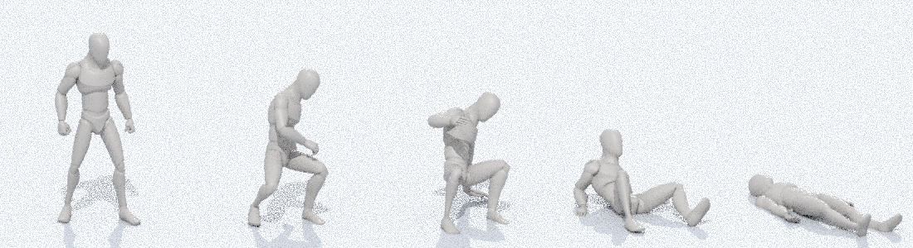 |
| `Sleep_Loop.glb` | lying on the back, slow breathing | 4.00 s (97 frames) | yes | UAL2 `LayToIdle` first pose + added breathing | CC0 | 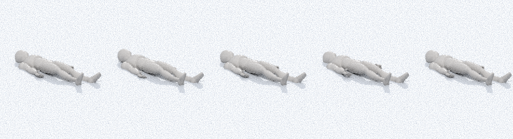 |
| `Sit_Eat_Loop.glb` | seated at a table: right hand from plate to mouth twice per loop, left hand on the table | 2.67 s (65 frames) | yes | UAL1 `Sitting_Idle_Loop` body + arm IK | CC0 | 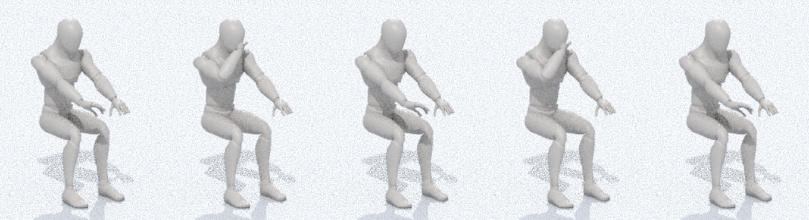 |
| `Sit_Type_Loop.glb` | seated at a desk, both hands on a keyboard, alternating taps | 2.00 s (49 frames) | yes | UAL1 `Sitting_Idle_Loop` body + arm IK | CC0 | 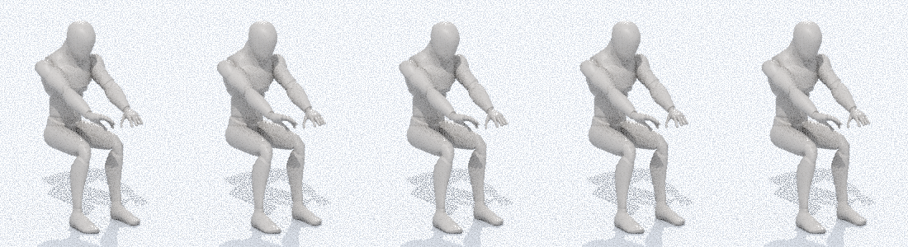 |
| `Cook_Stir_Loop.glb` | standing at a stove: left hand holds the pot handle, right hand stirs | 2.50 s (61 frames) | yes | UAL1 `Idle_Loop` body + arm IK | CC0 | 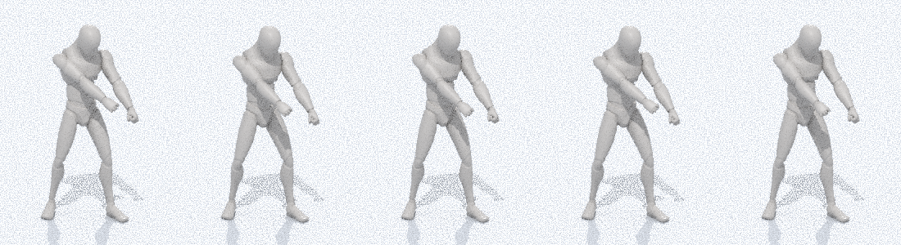 |
| `Shower_Loop.glb` | standing under a shower, both hands scrubbing the head | 2.67 s (65 frames) | yes | UAL1 `Idle_Loop` body + arm IK | CC0 | 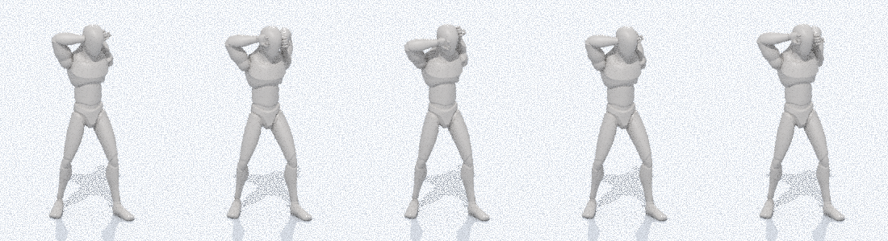 |
| `Carry_Idle_Loop.glb` | standing still while holding a box | 2.50 s (61 frames) | yes | UAL1 `Idle_Loop` body + UAL2 `Walk_Carry_Loop` arms | CC0 | 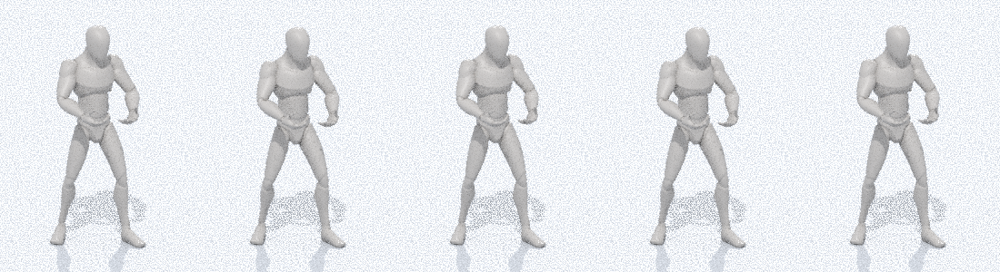 |

## Covering the requested actions
- **Lying down and getting up:** `Lie_Down`, `Get_Up`.
- **Sleeping:** `Sleep_Loop`.
- **Sitting at a table and eating:** `Sit_Down`, then `Sit_Eat_Loop`, then `Stand_Up`.
- **Cooking at a stove:** `Cook_Stir_Loop`.
- **Showering:** `Shower_Loop`.
- **Using a toilet:** `Sit_Down`, then `Sit_Idle_Loop`, then `Stand_Up`.
- **Typing at a computer:** `Sit_Type_Loop`.
- **Talking on a phone:** `Phone_Talk_Loop`.
- **Carrying a box:** `Pick_Up`, then `Carry_Walk_Loop` / `Carry_Idle_Loop`.
- **Getting in and out of a car seat:** `Sit_Down`, then `Car_Drive_Loop`, then `Stand_Up`. These are generic sit and stand movements; slide the character sideways into the seat in the game.
