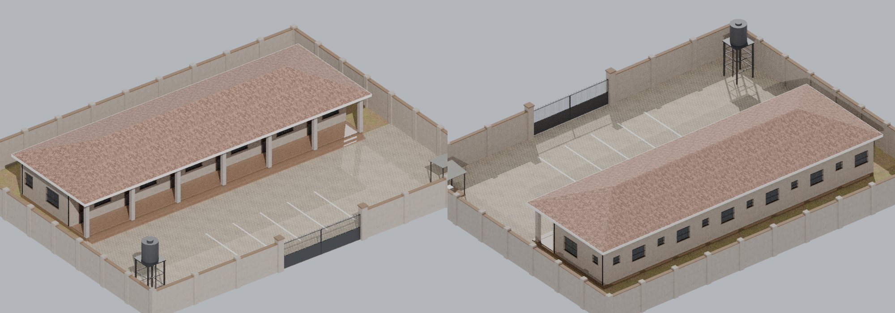
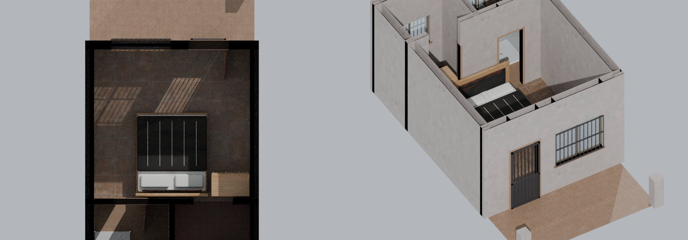
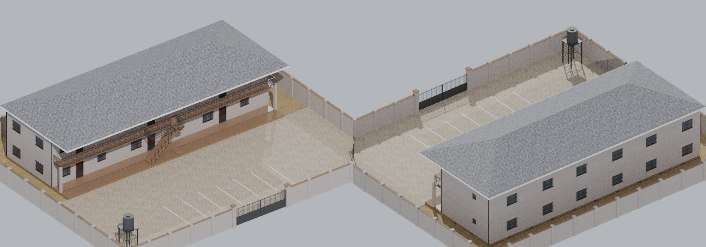
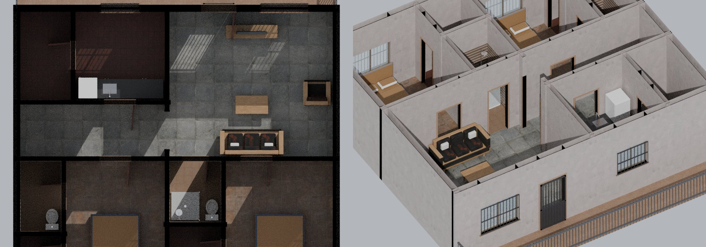
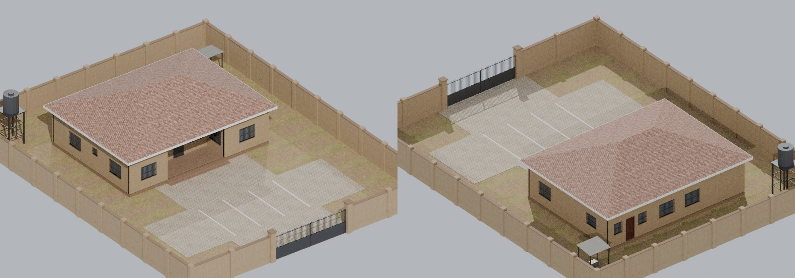
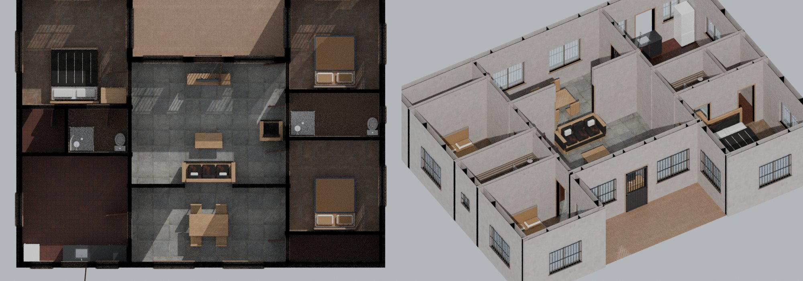
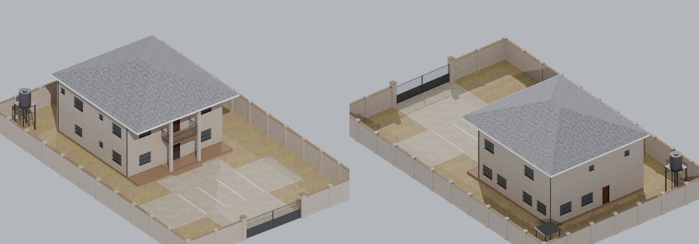
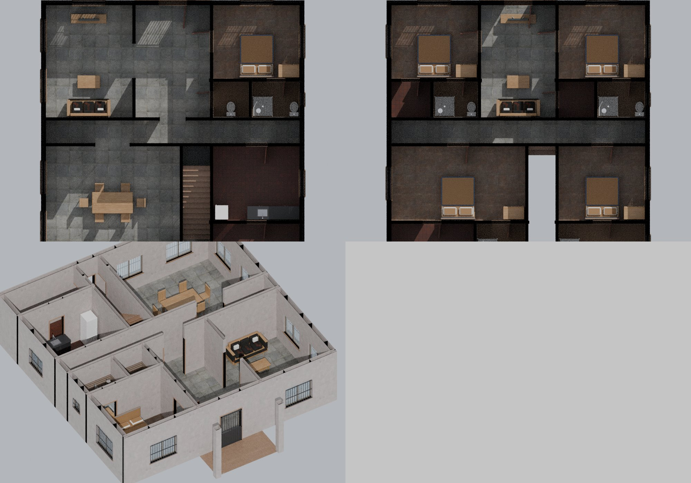
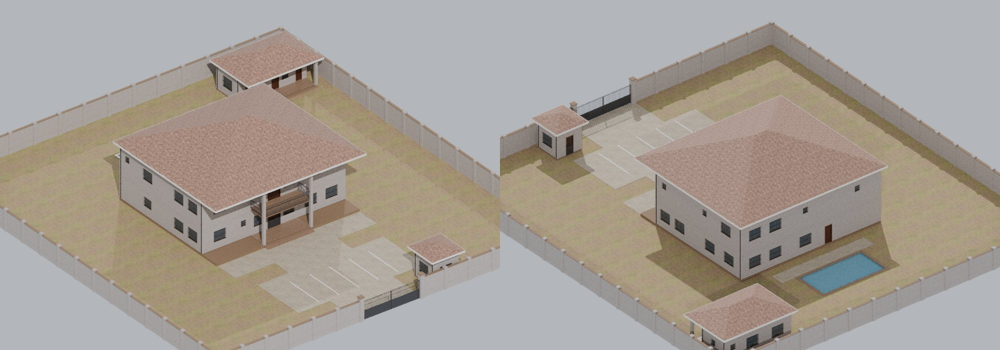
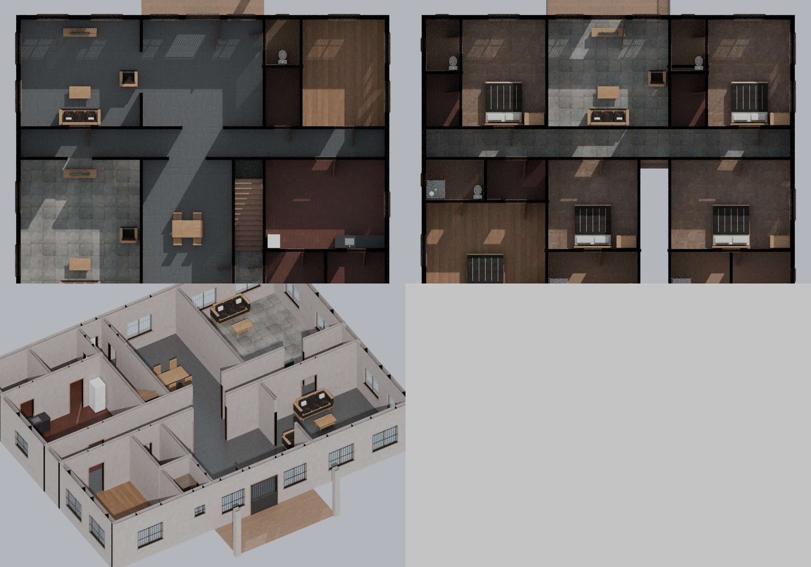

# Homes (`buildings/homes/`)

Phase 3 home buildings, one exterior (the building in its walled compound) and one interior per home type. Every resident gets a private copy of the interior, so a building never fills up.

**Licence:** modelled for Delta City by script (`source/homes/`, rerun with Blender 5.x): **CC0**. Textures are Poly Haven **CC0**, scaled to 512 px; the generator on its pad is `../../home/cooling-power/generator_large_green.glb` (Delta City, CC0). No logos or brand names.

## Conventions

- **Units and axes:** metres, +Y up. The **front faces +Z**: the gate in the compound wall and the main door of every interior.
- **Interior origin:** the centre of the home's footprint, on the ground-floor floor (y = 0). Upper floors are at y = 3.3; ceilings are 3.0 m above each floor.
- **Exterior origin:** the centre of the compound, on the ground. The building stands on a 0.3 m plinth (0.15 m for the boys' quarters and gatehouse), so its floor is 0.3 m above the compound ground. Two steps lead up at each entrance.
- **Doors** are separate nodes hinged at one jamb (origin on the hinge, at floor level). In the interior files they are exported **open** (turned 85 degrees about Y); turn them back to 0 to close. In the exterior files they are closed. Main doors have a barred steel security door in front (`..._security` node).
- **Gates:** `gate_left` / `gate_right`, each 3.6 m wide (7.2 m opening), hinged at the gate pillars. Rotate about Y to open.
- **Ceilings** are one node, `ceiling`, so the game can hide them for a top-down camera.
- **Windows:** every window has burglary-proof steel bars outside, an aluminium frame and glass (dark in exteriors, see-through in interiors).
- **Furniture:** rooms are laid out for `../../home/`. Each preview places real pieces from there (king and double beds, wardrobes, 3-seat sofas, TV stands, 4- and 6-seat dining sets, kitchen units, fridge, cooker, toilets and showers) to prove they fit.
- **Room rectangles** below and in `<type>.json` are measured on the wall centre lines, in the file's own space (x and z ranges).

## Files

| Type | For | Exterior | Interior | Colours |
|---|---|---|---|---|
| Row of 6 self-contained rooms | Quarters: Asaba Quarters, Warri Barracks, Ozoro Old Quarters, Agbor Boji Quarters | `room_exterior.glb`: compound 31 x 24 m, 11,970 triangles, 1132 KB | `room_interior.glb`: 4.2 x 7.8 m, 1 storey, 1,434 triangles, 358 KB | cream walls, red-brown roof |
| Block of 6 two-bedroom flats | Township | `flat_exterior.glb`: compound 38 x 32 m, 19,886 triangles, 1649 KB | `flat_interior.glb`: 10.2 x 10.2 m, 1 storey, 4,074 triangles, 585 KB | white walls, dark grey roof |
| Three-bedroom bungalow | Township | `bungalow_exterior.glb`: compound 24 x 30 m, 9,134 triangles, 951 KB | `bungalow_interior.glb`: 13.8 x 10.2 m, 1 storey, 6,022 triangles, 704 KB | ochre walls, red-brown roof |
| Five-bedroom duplex | GRA and Estate | `duplex_exterior.glb`: compound 22 x 34 m, 12,070 triangles, 1139 KB | `duplex_interior.glb`: 12.0 x 13.8 m, 2 storeys, 10,638 triangles, 1004 KB | cream walls, dark grey roof |
| Mansion with boys' quarters, gatehouse and pool | GRA and Estate | `mansion_exterior.glb`: compound 44 x 48 m, 20,074 triangles, 1710 KB | `mansion_interior.glb`: 18.0 x 16.2 m, 2 storeys, 15,110 triangles, 1350 KB | white walls, red-brown roof |

**Colour variants:** the walls use the material `wall_paint_exterior` and the roofs `roof_stone_coated`. Both are a neutral texture times a colour (glTF `baseColorFactor`), so the game can repaint them:
- walls: cream `[0.93, 0.88, 0.76]`, white `[0.96, 0.95, 0.92]`, ochre `[0.86, 0.68, 0.38]`;
- roofs: red-brown `[0.52, 0.27, 0.18]`, dark grey `[0.30, 0.30, 0.32]`.

## Row of 6 self-contained rooms

For: Quarters: Asaba Quarters, Warri Barracks, Ozoro Old Quarters, Agbor Boji Quarters.

**Exterior** (`room_exterior.glb`):

- Compound 31 x 24 m with a 2.4 m block wall, pillars and coping; steel double gate, 7.2 m wide, at the front centre `[0.0, 0, -12.0]`.
- Car park: 4 bays (2.5 x 5 m, painted lines); bay centres `[[-3.75, 0, 7.0], [-1.25, 0, 7.0], [1.25, 0, 7.0], [3.75, 0, 7.0]]`.
- Generator spot (concrete pad, canopy, a generator on it) at `[13.5, 0.12, 9.5]`; water-tank stand (3 m, 2,000-litre tank) at `[-13.5, 3.0, 9.0]`.
- Entrance doors (6), centre at floor level in compound space:
  - `door_f0_room_1_veranda_1`: `[-11.43, 0.3, -2.0]`, 0.9 m wide (main)
  - `door_f0_room_2_veranda_2`: `[-7.23, 0.3, -2.0]`, 0.9 m wide (main)
  - `door_f0_room_3_veranda_3`: `[-3.03, 0.3, -2.0]`, 0.9 m wide (main)
  - `door_f0_room_4_veranda_4`: `[1.17, 0.3, -2.0]`, 0.9 m wide (main)
  - `door_f0_room_5_veranda_5`: `[5.37, 0.3, -2.0]`, 0.9 m wide (main)
  - `door_f0_room_6_veranda_6`: `[9.57, 0.3, -2.0]`, 0.9 m wide (main)

**Interior** (`room_interior.glb`):

| Room | Kind | Floor | Size (m) | x range | z range |
|---|---|---|---|---|---|
| veranda | open | 0 | 4.2 x 2.0 | [-2.1, 2.1] | [1.9, 3.9] |
| room | bed | 0 | 4.2 x 4.0 | [-2.1, 2.1] | [-2.1, 1.9] |
| kitchenette | kitchen | 0 | 2.1 x 1.8 | [-2.1, 0.0] | [-3.9, -2.1] |
| shower | bath | 0 | 2.1 x 1.8 | [0.0, 2.1] | [-3.9, -2.1] |

Main door: `door_f0_room_veranda` at `[-0.93, 0.0, 1.9]`, 0.9 m wide (security door `door_f0_room_veranda_security`). 2 door nodes in all; their positions are in `room.json`.

## Block of 6 two-bedroom flats

For: Township.

**Exterior** (`flat_exterior.glb`):

- Compound 38 x 32 m with a 2.4 m block wall, pillars and coping; steel double gate, 7.2 m wide, at the front centre `[0.0, 0, -16.0]`.
- Car park: 6 bays (2.5 x 5 m, painted lines); bay centres `[[-6.25, 0, 10.0], [-3.75, 0, 10.0], [-1.25, 0, 10.0], [1.25, 0, 10.0], [3.75, 0, 10.0], [6.25, 0, 10.0]]`.
- Generator spot (concrete pad, canopy, a generator on it) at `[16.5, 0.12, 13.5]`; water-tank stand (3 m, 2,000-litre tank) at `[-16.6, 3.0, 13.0]`.
- Entrance doors (6), centre at floor level in compound space:
  - `door_f0_living_01_gallery`: `[-11.55, 0.3, -3.1]`, 1.0 m wide (main)
  - `door_f0_living_02_gallery`: `[-1.35, 0.3, -3.1]`, 1.0 m wide (main)
  - `door_f0_living_03_gallery`: `[8.85, 0.3, -3.1]`, 1.0 m wide (main)
  - `door_f1_living_11_gallery`: `[-11.55, 3.6, -3.1]`, 1.0 m wide (main)
  - `door_f1_living_12_gallery`: `[-1.35, 3.6, -3.1]`, 1.0 m wide (main)
  - `door_f1_living_13_gallery`: `[8.85, 3.6, -3.1]`, 1.0 m wide (main)

**Interior** (`flat_interior.glb`):

| Room | Kind | Floor | Size (m) | x range | z range |
|---|---|---|---|---|---|
| living | living | 0 | 5.4 x 4.8 | [-5.1, 0.3] | [-1.2, 3.6] |
| kitchen | kitchen | 0 | 3.0 x 3.0 | [0.3, 3.3] | [0.6, 3.6] |
| store | store | 0 | 1.8 x 3.0 | [3.3, 5.1] | [0.6, 3.6] |
| hall | corridor | 0 | 4.8 x 1.8 | [0.3, 5.1] | [-1.2, 0.6] |
| bedroom2 | bed | 0 | 3.6 x 3.9 | [-5.1, -1.5] | [-5.1, -1.2] |
| bathroom | bath | 0 | 1.8 x 2.1 | [-1.5, 0.3] | [-3.3, -1.2] |
| linen | store | 0 | 1.8 x 1.8 | [-1.5, 0.3] | [-5.1, -3.3] |
| master | bed | 0 | 3.3 x 3.9 | [0.3, 3.6] | [-5.1, -1.2] |
| ensuite | bath | 0 | 1.5 x 2.4 | [3.6, 5.1] | [-3.6, -1.2] |
| wardrobe | store | 0 | 1.5 x 1.5 | [3.6, 5.1] | [-5.1, -3.6] |
| gallery | open | 0 | 10.2 x 1.5 | [-5.1, 5.1] | [3.6, 5.1] |

Main door: `door_f0_living_gallery` at `[-1.35, 0.0, 3.6]`, 1.0 m wide (security door `door_f0_living_gallery_security`). 9 door nodes in all; their positions are in `flat.json`.

## Three-bedroom bungalow

For: Township.

**Exterior** (`bungalow_exterior.glb`):

- Compound 24 x 30 m with a 2.4 m block wall, pillars and coping; steel double gate, 7.2 m wide, at the front centre `[0.0, 0, -15.0]`.
- Car park: 3 bays (2.5 x 5 m, painted lines); bay centres `[[-2.5, 0, 7.5], [0.0, 0, 7.5], [2.5, 0, 7.5]]`.
- Generator spot (concrete pad, canopy, a generator on it) at `[9.5, 0.12, -11.5]`; water-tank stand (3 m, 2,000-litre tank) at `[-9.5, 3.0, -12.5]`.
- Entrance doors (2), centre at floor level in compound space:
  - `door_f0_living_veranda`: `[-0.3, 0.3, -2.4]`, 1.0 m wide (main)
  - `door_f0_kitchen_out`: `[4.8, 0.3, -10.2]`, 0.9 m wide (back)

**Interior** (`bungalow_interior.glb`):

| Room | Kind | Floor | Size (m) | x range | z range |
|---|---|---|---|---|---|
| bedroom3 | bed | 0 | 3.6 x 3.6 | [-6.9, -3.3] | [1.5, 5.1] |
| veranda | open | 0 | 6.0 x 2.4 | [-3.3, 2.7] | [2.7, 5.1] |
| master | bed | 0 | 4.2 x 4.2 | [2.7, 6.9] | [0.9, 5.1] |
| living | living | 0 | 6.0 x 4.8 | [-3.3, 2.7] | [-2.1, 2.7] |
| bathroom | bath | 0 | 3.6 x 1.8 | [-6.9, -3.3] | [-0.3, 1.5] |
| ensuite | bath | 0 | 2.4 x 1.8 | [2.7, 5.1] | [-0.9, 0.9] |
| wardrobe | store | 0 | 1.8 x 1.8 | [5.1, 6.9] | [-0.9, 0.9] |
| bedroom2 | bed | 0 | 3.6 x 3.6 | [-6.9, -3.3] | [-3.9, -0.3] |
| laundry | store | 0 | 3.6 x 1.2 | [-6.9, -3.3] | [-5.1, -3.9] |
| dining | dining | 0 | 6.0 x 3.0 | [-3.3, 2.7] | [-5.1, -2.1] |
| kitchen | kitchen | 0 | 4.2 x 4.2 | [2.7, 6.9] | [-5.1, -0.9] |

Main door: `door_f0_living_veranda` at `[-0.3, 0.0, 2.7]`, 1.0 m wide (security door `door_f0_living_veranda_security`). 10 door nodes in all; their positions are in `bungalow.json`.

## Five-bedroom duplex

For: GRA and Estate.

**Exterior** (`duplex_exterior.glb`):

- Compound 22 x 34 m with a 2.4 m block wall, pillars and coping; steel double gate, 7.2 m wide, at the front centre `[0.0, 0, -17.0]`.
- Car park: 3 bays (2.5 x 5 m, painted lines); bay centres `[[-2.5, 0, 8.0], [0.0, 0, 8.0], [2.5, 0, 8.0]]`.
- Generator spot (concrete pad, canopy, a generator on it) at `[8.5, 0.12, -14.5]`; water-tank stand (3 m, 2,000-litre tank) at `[-8.5, 3.0, -14.5]`.
- Entrance doors (2), centre at floor level in compound space:
  - `door_f0_hall_porch`: `[-0.0, 0.3, -0.0]`, 1.2 m wide (main)
  - `door_f0_backhall_out`: `[-1.1, 0.3, -12.0]`, 0.9 m wide (back)

**Interior** (`duplex_interior.glb`):

| Room | Kind | Floor | Size (m) | x range | z range |
|---|---|---|---|---|---|
| porch | open | 0 | 3.6 x 1.8 | [-1.8, 1.8] | [5.1, 6.9] |
| guest | bed | 0 | 4.2 x 3.6 | [-6.0, -1.8] | [1.5, 5.1] |
| guest_bath | bath | 0 | 2.4 x 1.8 | [-6.0, -3.6] | [-0.3, 1.5] |
| wc | wc | 0 | 1.8 x 1.8 | [-3.6, -1.8] | [-0.3, 1.5] |
| hall | hall | 0 | 3.6 x 5.4 | [-1.8, 1.8] | [-0.3, 5.1] |
| living | living | 0 | 4.2 x 5.4 | [1.8, 6.0] | [-0.3, 5.1] |
| corridor | corridor | 0 | 12.0 x 1.2 | [-6.0, 6.0] | [-1.5, -0.3] |
| kitchen | kitchen | 0 | 4.2 x 3.6 | [-6.0, -1.8] | [-5.1, -1.5] |
| store | store | 0 | 4.2 x 1.8 | [-6.0, -1.8] | [-6.9, -5.1] |
| stair | stair | 0 | 1.4 x 4.4 | [-1.8, -0.4] | [-5.9, -1.5] |
| backhall | corridor | 0 | 1.4 x 1.0 | [-1.8, -0.4] | [-6.9, -5.9] |
| dining | dining | 0 | 6.4 x 5.4 | [-0.4, 6.0] | [-6.9, -1.5] |
| balcony | open | 1 | 3.6 x 1.8 | [-1.8, 1.8] | [5.1, 6.9] |
| bedroom2 | bed | 1 | 4.2 x 3.6 | [-6.0, -1.8] | [1.5, 5.1] |
| bath2 | bath | 1 | 2.4 x 1.8 | [-6.0, -3.6] | [-0.3, 1.5] |
| linen | store | 1 | 1.8 x 1.8 | [-3.6, -1.8] | [-0.3, 1.5] |
| lounge | lounge | 1 | 3.6 x 5.4 | [-1.8, 1.8] | [-0.3, 5.1] |
| master | bed | 1 | 4.2 x 3.6 | [1.8, 6.0] | [1.5, 5.1] |
| master_bath | bath | 1 | 2.2 x 1.8 | [1.8, 4.0] | [-0.3, 1.5] |
| dressing | store | 1 | 2.0 x 1.8 | [4.0, 6.0] | [-0.3, 1.5] |
| corridor_up | corridor | 1 | 12.0 x 1.2 | [-6.0, 6.0] | [-1.5, -0.3] |
| bedroom3 | bed | 1 | 4.2 x 3.6 | [-6.0, -1.8] | [-5.1, -1.5] |
| bath3 | bath | 1 | 4.2 x 1.8 | [-6.0, -1.8] | [-6.9, -5.1] |
| stairwell | void | 1 | 1.4 x 5.4 | [-1.8, -0.4] | [-6.9, -1.5] |
| bedroom4 | bed | 1 | 6.4 x 3.6 | [-0.4, 6.0] | [-5.1, -1.5] |
| bath4 | bath | 1 | 2.4 x 1.8 | [-0.4, 2.0] | [-6.9, -5.1] |
| store4 | store | 1 | 4.0 x 1.8 | [2.0, 6.0] | [-6.9, -5.1] |

Main door: `door_f0_hall_porch` at `[-0.0, 0.0, 5.1]`, 1.2 m wide (security door `door_f0_hall_porch_security`). 21 door nodes in all; their positions are in `duplex.json`.

## Mansion with boys' quarters, gatehouse and pool

For: GRA and Estate.

**Exterior** (`mansion_exterior.glb`):

- Compound 44 x 48 m with a 2.4 m block wall, pillars and coping; steel double gate, 7.2 m wide, at the front centre `[0.0, 0, -24.0]`.
- Car park: 4 bays (2.5 x 5 m, painted lines); bay centres `[[-3.75, 0, 16.0], [-1.25, 0, 16.0], [1.25, 0, 16.0], [3.75, 0, 16.0]]`.
- Generator spot (concrete pad, canopy, a generator on it) at `[-19.5, 0.12, -18.5]`; water-tank stand (3 m, 2,000-litre tank) at `[-19.0, 3.0, -21.5]`.
- Swimming pool 8 x 4 m, 1.5 m deep, water 0.15 m below the coping: x `[-4.0, 4.0]`, z `[-17.0, -13.0]`.
- Also in the compound: boys quarters, gatehouse (doors: bq_door_f0_bq_room1_bq_veranda, bq_door_f0_bq_room2_bq_veranda, bq_door_f0_bq_bath_bq_veranda, gh_door_f0_gatehouse_out).
- Entrance doors (2), centre at floor level in compound space:
  - `door_f0_foyer_portico`: `[0.0, 0.3, 4.0]`, 1.6 m wide (main)
  - `door_f0_backhall_out`: `[-2.25, 0.3, -9.8]`, 0.9 m wide (back)

**Interior** (`mansion_interior.glb`):

| Room | Kind | Floor | Size (m) | x range | z range |
|---|---|---|---|---|---|
| portico | open | 0 | 6.0 x 2.4 | [-3.0, 3.0] | [5.7, 8.1] |
| study | study | 0 | 4.2 x 5.4 | [-9.0, -4.8] | [0.3, 5.7] |
| wc | wc | 0 | 1.8 x 2.4 | [-4.8, -3.0] | [3.3, 5.7] |
| cloak | store | 0 | 1.8 x 3.0 | [-4.8, -3.0] | [0.3, 3.3] |
| foyer | hall | 0 | 6.0 x 5.4 | [-3.0, 3.0] | [0.3, 5.7] |
| living | living | 0 | 6.0 x 5.4 | [3.0, 9.0] | [0.3, 5.7] |
| corridor | corridor | 0 | 18.0 x 1.5 | [-9.0, 9.0] | [-1.2, 0.3] |
| kitchen | kitchen | 0 | 6.0 x 4.5 | [-9.0, -3.0] | [-5.7, -1.2] |
| pantry | store | 0 | 3.0 x 2.4 | [-9.0, -6.0] | [-8.1, -5.7] |
| laundry | store | 0 | 3.0 x 2.4 | [-6.0, -3.0] | [-8.1, -5.7] |
| stair | stair | 0 | 1.5 x 4.5 | [-3.0, -1.5] | [-5.7, -1.2] |
| backhall | corridor | 0 | 1.5 x 2.4 | [-3.0, -1.5] | [-8.1, -5.7] |
| dining | dining | 0 | 4.5 x 6.9 | [-1.5, 3.0] | [-8.1, -1.2] |
| family | family | 0 | 6.0 x 6.9 | [3.0, 9.0] | [-8.1, -1.2] |
| balcony | open | 1 | 6.0 x 2.4 | [-3.0, 3.0] | [5.7, 8.1] |
| bedroom2 | bed | 1 | 4.2 x 5.4 | [-9.0, -4.8] | [0.3, 5.7] |
| bath2 | bath | 1 | 1.8 x 2.7 | [-4.8, -3.0] | [3.0, 5.7] |
| wardrobe2 | store | 1 | 1.8 x 2.7 | [-4.8, -3.0] | [0.3, 3.0] |
| lounge | lounge | 1 | 6.0 x 5.4 | [-3.0, 3.0] | [0.3, 5.7] |
| bedroom5 | bed | 1 | 4.2 x 5.4 | [3.0, 7.2] | [0.3, 5.7] |
| bath5 | bath | 1 | 1.8 x 2.7 | [7.2, 9.0] | [3.0, 5.7] |
| wardrobe5 | store | 1 | 1.8 x 2.7 | [7.2, 9.0] | [0.3, 3.0] |
| corridor_up | corridor | 1 | 18.0 x 1.5 | [-9.0, 9.0] | [-1.2, 0.3] |
| bedroom3 | bed | 1 | 6.0 x 4.5 | [-9.0, -3.0] | [-5.7, -1.2] |
| bath3 | bath | 1 | 6.0 x 2.4 | [-9.0, -3.0] | [-8.1, -5.7] |
| stairwell | void | 1 | 1.5 x 6.9 | [-3.0, -1.5] | [-8.1, -1.2] |
| bedroom4 | bed | 1 | 4.5 x 4.5 | [-1.5, 3.0] | [-5.7, -1.2] |
| bath4 | bath | 1 | 4.5 x 2.4 | [-1.5, 3.0] | [-8.1, -5.7] |
| dressing | store | 1 | 3.0 x 2.1 | [3.0, 6.0] | [-3.3, -1.2] |
| master_bath | bath | 1 | 3.0 x 2.1 | [6.0, 9.0] | [-3.3, -1.2] |
| master | bed | 1 | 6.0 x 4.8 | [3.0, 9.0] | [-8.1, -3.3] |

Main door: `door_f0_foyer_portico` at `[0.0, 0.0, 5.7]`, 1.6 m wide (security door `door_f0_foyer_portico_security`). 25 door nodes in all; their positions are in `mansion.json`.

## Notes

- **Tested** in three.js r160 at phone (375 px) and desktop size: all ten files load with no errors, 0.1 to 0.2 s each; door and gate nodes present.
- Room kinds: `open` = veranda, porch, balcony or gallery; `void` = stairwell opening on the upper floor; `stair` = indoor stair, rising from the ground floor; `stair_open` = the flats' outdoor stair.
- The flats' upper gallery is reached by the open stair in front of the block; the gallery has a steel railing. The interior file for a flat includes its stretch of gallery with a railing.
- Interiors have no outside ground or roof; exteriors have no interior rooms (windows are dark glass).
