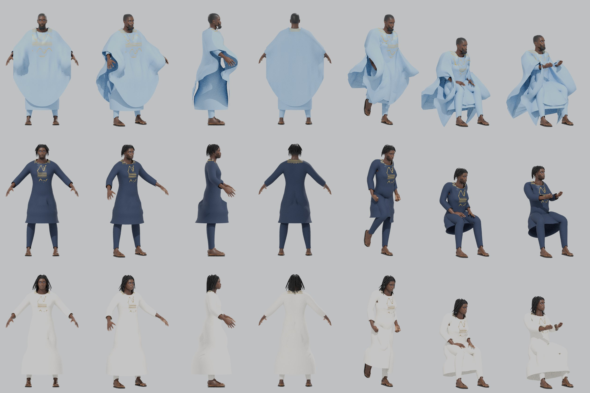
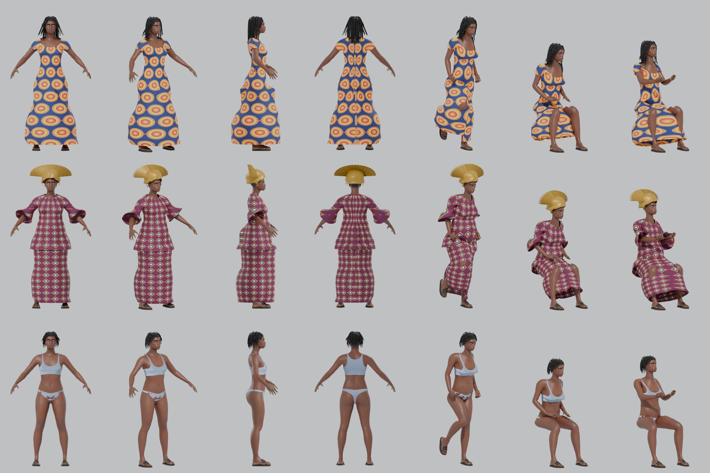

# Modular characters (MPFB 2)

Material for a Sims-style character creator, made with **MPFB 2.0.18** (the MakeHuman plugin) in Blender 5.2 from the official MakeHuman asset packs. Everything here is **CC0** except 34 hairstyles from Hair 02 and Hair 03, which are **CC-BY** (credits in `../CREDITS.md`, "Credits required").

## How the pieces go together

- **One skeleton per body.** Every `.glb` here carries the 53-bone `game_engine` rig with the same bone names in the same order. All female files share one rest pose and all male files another (checked: all 339 pieces match their body exactly); the female and male rest poses differ only because the bodies differ in size. Load a base body, then load pieces for that sex and bind them to the body's skeleton by bone name.
- **Bodies:** `base_female.glb`, `base_male.glb` and four face presets each (`base_<sex>_face1-4.glb`). Average build, African features (MakeHuman race slider fully "African"), with eyes, eyebrows (`eyebrow001`), eyelashes (`eyelashes01`) and plain underwear as separate meshes. Textures at most 1024 px.
- **Pieces** are fitted separately to each body, so most come as `<item>_female.glb` and `<item>_male.glb`. The body is left out; each piece has only its own mesh and the rig.
- **Hiding the body under clothes** (`hide_lists.json`). Pieces sit close to the skin, so the body must be hidden under them or it pokes through. Every vertex of each base body carries its original MakeHuman vertex number in the custom attribute `_MHVERT` (glTF attribute `_MHVERT`). For each worn piece, `hide_lists.json` gives vertex-number ranges: **hide every body triangle whose three corners are all in the list.** `hide_base_nodes` also names the base underwear meshes to hide (e.g. tops and dresses hide the bra). This is how the fit previews were made. 60 pieces use their own MakeHuman delete list; 13 that have none use the body vertices they are fitted to.
- **Skins** (`skins/`) and **eye colours** (`eyes/`) are colour textures for the shared MakeHuman UV layout: swap the body or eye material's base-colour texture. Most MakeHuman skins paint anatomical detail (nipples, body hair); the bodies always wear underwear, so this does not show.
- **Colour variants**: `<item>__<variant>.jpg/.png` beside a piece is a replacement base-colour texture for that piece (same UVs).
- **Thumbnails**: `<item>_<sex>.png` beside each piece, front view.

## Materials: opaque, cut-out, blend

All materials were set to alpha blending when they were exported, which made renderers sort them badly (underwear hidden behind the skin, smeared eyes). Each material now uses the cheapest mode that looks right. This was decided by sampling every texture's alpha where the mesh actually uses it (at the vertices and inside every triangle):

- **Opaque** (`alphaMode` left at the default): bodies, base underwear and every piece whose texture is solid wherever the mesh samples it.
- **Cut-out** (`alphaMode` MASK, `alphaCutoff` 0.5, i.e. alpha test): hair, eyebrows, eyelashes, the eyes (their outer cornea shell is fully clear, so it is cut away and the eyeball stays solid), and pieces that use real holes (lace, frills, rings, the helmet visor).
- **Blend** (`alphaMode` BLEND): only the glasses (see-through lenses) and the pantyhose (sheer). These were already blend and are unchanged.
- Only the material settings in each file changed; meshes, rigs and textures are byte-for-byte the same.

Changed: 376 materials in 331 files.

| Folder | Now opaque | Now cut-out |
|---|---|---|
| bodies (`base_*.glb`, all 10) | body and underwear materials | eyebrows, eyelashes and eyes |
| `tops/` | `elvs_crude_t-shirt_male_male`, `joepal_crude_t-shirt_female_female`, `namuhekam_male_polo_shirt_male`, `skalldyrssuppe_tube_top_funky_colors_female`, `toigo_basic_tucked_t-shirt_female`, `toigo_basic_tucked_t-shirt_male`, `toigo_bodice-style_top_female`, `toigo_fisherman_sweater_female`, `toigo_fisherman_sweater_male`, `toigo_keyhole_tank_top_female`, `toigo_turtleneck_halter_top_female` | `toigo_camisole_top_female` |
| `bottoms/` | `cortu_cargo_pants_female`, `cortu_cargo_pants_male`, `cortu_jeans_shorts_female`, `frankyaye_mini_skirt_01_female`, `frankyaye_mini_skirt_02_female`, `toigo_harem_pants_female`, `toigo_harem_pants_male`, `toigo_long_full_skirt_female`, `toigo_tiered_mini_skirt_female`, `toigo_tiered_skirt_female`, `toigo_wool_pants_male` | `toigo_skirt_with_lace_ruffle_female` |
| `dresses/` | `mindfront_kimono_female`, `toigo_camisole_dress_with_full_skirt_female`, `toigo_cut_out_dress_female`, `toigo_dress_with_tiered_skirt_female`, `toigo_halter_dress_knee_length_female`, `toigo_halter_dress_midi_female`, `toigo_halter_dress_with_fluted_skirt_female`, `toigo_keyhole_neck_dress_female`, `toigo_shift_dress_female` | `toigo_bodice_dress_with_lace_ruffle_skirt_female`, `toigo_strapless_ruffle_top_dress_female` |
| `outfits/` | `female_casualsuit01_female`, `female_casualsuit02_female`, `female_elegantsuit01_female`, `female_sportsuit01_female`, `male_casualsuit01_male`, `male_casualsuit02_male`, `male_casualsuit03_male`, `male_casualsuit04_male`, `male_casualsuit05_male`, `male_casualsuit06_male`, `male_elegantsuit01_male`, `male_worksuit01_male`, `toigo_female_double-breasted_suit_female`, `toigo_female_suit_2_female`, `toigo_female_suit_female`, `toigo_male_double-breasted_suit_male`, `toigo_male_suit_3_male`, `toigo_male_suit_tie_and_jacket_male`, `toigo_suit_with_dinner_jacket_male`, `toigo_suit_with_jacket_and_bowtie_male` |  |
| `shoes/` | `cortu_floppy_overknee_shoes_female`, `cortu_t-bar_female`, `culturalibre_male_boots_male`, `shoes01_female`, `shoes01_male`, `shoes02_female`, `shoes02_male`, `shoes03_female`, `shoes03_male`, `shoes04_female`, `shoes04_male`, `shoes05_female`, `shoes05_male`, `shoes06_female`, `shoes06_male`, `toigo_ankle_boots_female_female`, `toigo_ankle_boots_male_male`, `toigo_ballet_flats_female`, `toigo_ballet_flats_with_bows_female`, `toigo_ballet_flats_with_flowers_female`, `toigo_flats_female`, `toigo_mj_cloth_shoes_female`, `toigo_mj_cloth_shoes_male`, `toigo_stiletto_booties_female` |  |
| `accessories/` | `aethelraed_unraed_cloche_hat_female`, `aethelraed_unraed_cloche_hat_male`, `ews_hoop_earrings_female`, `ews_hoop_earrings_male`, `ews_industrial_piercing_left_ear__female`, `ews_industrial_piercing_left_ear__male`, `ews_industrial_piercing_right_ear__female`, `ews_industrial_piercing_right_ear__male`, `ews_septum_ring_female`, `ews_septum_ring_male`, `fedora01_female`, `fedora01_male`, `fedora_cocked_female`, `fedora_cocked_male`, `grinsegold_uncle_joshis_hat_female`, `grinsegold_uncle_joshis_hat_male`, `joachip_ring_1_female`, `joachip_ring_1_male`, `joepal_crude_high_socks_female`, `joepal_crude_high_socks_male`, `joepal_crude_low_socks_female`, `joepal_crude_low_socks_male`, `spamrakuen_tbm_glasses_frames_01_female`, `spamrakuen_tbm_glasses_frames_01_male`, `toigo_leg_warmer_socks_female`, `toigo_leg_warmer_socks_male`, `toigo_pearl_earrings_female`, `toigo_pearl_earrings_male`, `toigo_pearl_necklace_female`, `toigo_pearl_necklace_male`, `wolgade_diamond_ring_01_female`, `wolgade_diamond_ring_01_male` | `culturalibre_motorcycle_helmet_female`, `culturalibre_motorcycle_helmet_male`, `punkduck_lace-choker_female`, `punkduck_lace-choker_male`, `toigo_diamond_ring_and_wedding_band_female`, `toigo_diamond_ring_and_wedding_band_male`, `toigo_lace_frill_socks_female`, `toigo_lace_frill_socks_male`, `toigo_wedding_ring_female`, `toigo_wedding_ring_male` |
| `hair/` | | all 130 files |
| `eyebrows/` | | all 52 files |
| `eyelashes/` | | all 18 files |

Fit previews (rendered with the materials exactly as stored): `previews/fit_female_front.png`, `fit_female_angle.png`, `fit_male_front.png`, `fit_male_angle.png`.
Overlaps between two pieces (a T-shirt hem over a trouser waist, tall boots under trouser legs) still show in places; that is layering, not the material.

## Skeleton (53 bones, `game_engine` rig)

`Root`, `pelvis`, `spine_01`, `spine_02`, `spine_03`, `clavicle_l`, `upperarm_l`, `lowerarm_l`, `hand_l`, `index_01_l`, `index_02_l`, `index_03_l`, `middle_01_l`, `middle_02_l`, `middle_03_l`, `pinky_01_l`, `pinky_02_l`, `pinky_03_l`, `ring_01_l`, `ring_02_l`, `ring_03_l`, `thumb_01_l`, `thumb_02_l`, `thumb_03_l`, `clavicle_r`, `upperarm_r`, `lowerarm_r`, `hand_r`, `index_01_r`, `index_02_r`, `index_03_r`, `middle_01_r`, `middle_02_r`, `middle_03_r`, `pinky_01_r`, `pinky_02_r`, `pinky_03_r`, `ring_01_r`, `ring_02_r`, `ring_03_r`, `thumb_01_r`, `thumb_02_r`, `thumb_03_r`, `neck_01`, `head`, `thigh_l`, `calf_l`, `foot_l`, `ball_l`, `thigh_r`, `calf_r`, `foot_r`, `ball_r`

## Bodies

| File | Triangles (body + eyes, brows, lashes, underwear) | Size | Height | Licence |
|---|---|---|---|---|
| `base_female.glb` | 33,030 (26,756 body) | 4.6 MB | 1.67 m | CC0 |
| `base_female_face1.glb` | 33,030 (26,756 body) | 4.6 MB | 1.67 m | CC0 |
| `base_female_face2.glb` | 33,030 (26,756 body) | 4.6 MB | 1.69 m | CC0 |
| `base_female_face3.glb` | 33,030 (26,756 body) | 4.6 MB | 1.67 m | CC0 |
| `base_female_face4.glb` | 33,030 (26,756 body) | 4.6 MB | 1.69 m | CC0 |
| `base_male.glb` | 29,856 (26,756 body) | 3.5 MB | 1.81 m | CC0 |
| `base_male_face1.glb` | 29,856 (26,756 body) | 3.5 MB | 1.81 m | CC0 |
| `base_male_face2.glb` | 29,856 (26,756 body) | 3.5 MB | 1.83 m | CC0 |
| `base_male_face3.glb` | 29,856 (26,756 body) | 3.5 MB | 1.81 m | CC0 |
| `base_male_face4.glb` | 29,856 (26,756 body) | 3.5 MB | 1.83 m | CC0 |

Face presets differ from the base only in face shape (nose, lips, chin, cheeks, eyes, forehead targets); the skeleton, UV layout and everything below the neck are identical. 1: broader nose and fuller lips; 2: longer face, high cheekbones; 3: rounder, fuller cheeks; 4: strong chin and brow, wide nose.

## Body shapes (slim / heavy) as shape keys

**Feasible on both bodies and clothes.** Test: the female body and the `toigo_basic_tucked_t-shirt` were built at MakeHuman weight 0.0, 0.5 and 1.0. Vertex counts match at every weight (`True`), so `slim` and `heavy` became shape keys on the body **and** on the shirt, and both exported as glTF morph targets (checked in the files). Notes for doing it for real:
- MakeHuman's weight slider changes the shape only a little (at most about 2.3 cm per vertex at the extremes). For visible slim/heavy bodies, build the shape keys from weight plus muscle and proportions, or allow key values above 1.
- Every piece must be fitted once per body shape to get its matching key; that is a re-run of the same export with the other weights.
- Shape keys need the helper geometry deleted from the body (not just masked), which the test script does.
- The skeleton is not refitted per shape key, so joints stay at the average body's positions (normal for game characters).

## Skins (light to very dark) and eye colours

| File | Size | Source | Licence |
|---|---|---|---|
| `skins/01_old_caucasian_male.jpg` | 179 KB | MakeHuman `makehuman_system_assets` | CC0 |
| `skins/02_toigo_light_skin_male_with_goth_makeup.jpg` | 119 KB | MakeHuman `skins02` | CC0 |
| `skins/03_old_caucasian_female.jpg` | 156 KB | MakeHuman `makehuman_system_assets` | CC0 |
| `skins/04_middleage_asian_female.jpg` | 111 KB | MakeHuman `makehuman_system_assets` | CC0 |
| `skins/05_toigo_light_skin_male_with_eyeliner.jpg` | 132 KB | MakeHuman `skins02` | CC0 |
| `skins/06_toigo_light_skin_male_with_emo_eyes.jpg` | 132 KB | MakeHuman `skins02` | CC0 |
| `skins/07_young_caucasian_male.jpg` | 134 KB | MakeHuman `makehuman_system_assets` | CC0 |
| `skins/08_toigo_light_skin_male_freckles.jpg` | 169 KB | MakeHuman `skins02` | CC0 |
| `skins/09_onlytheghosts_middle_aged_eurasian_female.jpg` | 119 KB | MakeHuman `skins01` | CC0 |
| `skins/10_middleage_asian_male.jpg` | 138 KB | MakeHuman `makehuman_system_assets` | CC0 |
| `skins/11_toigo_light_skin_male_ginger.jpg` | 240 KB | MakeHuman `skins02` | CC0 |
| `skins/12_mindfront_aksel_skin.jpg` | 133 KB | MakeHuman `skins02` | CC0 |
| `skins/13_middleage_caucasian_male.jpg` | 132 KB | MakeHuman `makehuman_system_assets` | CC0 |
| `skins/14_middleage_caucasian_female.jpg` | 126 KB | MakeHuman `makehuman_system_assets` | CC0 |
| `skins/15_onlytheghosts_old_eurasian_female.jpg` | 156 KB | MakeHuman `skins01` | CC0 |
| `skins/16_ken1138_caucasian_male_tattooed_skin.jpg` | 146 KB | MakeHuman `skins02` | CC0 |
| `skins/17_onlytheghosts_young_eurasian_female.jpg` | 132 KB | MakeHuman `skins01` | CC0 |
| `skins/18_young_caucasian_female.jpg` | 144 KB | MakeHuman `makehuman_system_assets` | CC0 |
| `skins/19_onlytheghosts_old_eurasian_male.jpg` | 169 KB | MakeHuman `skins02` | CC0 |
| `skins/20_young_asian_female.jpg` | 119 KB | MakeHuman `makehuman_system_assets` | CC0 |
| `skins/21_young_caucasian_male2.jpg` | 127 KB | MakeHuman `makehuman_system_assets` | CC0 |
| `skins/22_young_asian_male.jpg` | 126 KB | MakeHuman `makehuman_system_assets` | CC0 |
| `skins/23_young_caucasian_female2.jpg` | 118 KB | MakeHuman `makehuman_system_assets` | CC0 |
| `skins/24_flower-angel_red_head_skin.jpg` | 123 KB | MakeHuman `skins01` | CC0 |
| `skins/25_darthfurby_caucasian_female.jpg` | 119 KB | MakeHuman `skins01` | CC0 |
| `skins/26_toigo_light_skin_female_ginger_with_makeup.jpg` | 190 KB | MakeHuman `skins01` | CC0 |
| `skins/27_toigo_light_skin_female_ginger_2.jpg` | 224 KB | MakeHuman `skins01` | CC0 |
| `skins/28_toigo_light_skin_female_ginger.jpg` | 189 KB | MakeHuman `skins01` | CC0 |
| `skins/29_nyloseth_zoeyskin.jpg` | 189 KB | MakeHuman `skins01` | CC0 |
| `skins/30_toigo_light_skin_with_makeup.jpg` | 116 KB | MakeHuman `skins01` | CC0 |
| `skins/31_toigo_light_skin_female_with_violet_makeup.jpg` | 112 KB | MakeHuman `skins01` | CC0 |
| `skins/32_toigo_light_skin_female_freckles.jpg` | 163 KB | MakeHuman `skins01` | CC0 |
| `skins/33_toigo_light_skin_female_bronze.jpg` | 96 KB | MakeHuman `skins01` | CC0 |
| `skins/34_old_asian_female.jpg` | 158 KB | MakeHuman `makehuman_system_assets` | CC0 |
| `skins/35_toigo_light_skin_male_bronze.jpg` | 127 KB | MakeHuman `skins02` | CC0 |
| `skins/36_toigo_light_skin_with_natural_makeup.jpg` | 112 KB | MakeHuman `skins01` | CC0 |
| `skins/37_old_asian_male.jpg` | 160 KB | MakeHuman `makehuman_system_assets` | CC0 |
| `skins/38_toigo_light_skin_female_bronze_with_makeup.jpg` | 107 KB | MakeHuman `skins01` | CC0 |
| `skins/39_cutoff3d_indian_female_skin.jpg` | 150 KB | MakeHuman `skins01` | CC0 |
| `skins/40_rehmanpolanski_skin_viking_tattoos.jpg` | 153 KB | MakeHuman `skins02` | CC0 |
| `skins/41_skalldyrssuppe_creamy_female.jpg` | 107 KB | MakeHuman `skins01` | CC0 |
| `skins/42_callharvey3d_midtoned_female.jpg` | 103 KB | MakeHuman `skins01` | CC0 |
| `skins/43_cutoff3d_indian_female_enhanced.jpg` | 153 KB | MakeHuman `skins01` | CC0 |
| `skins/44_mindfront_skin_male_african_middleage.jpg` | 170 KB | MakeHuman `skins02` | CC0 |
| `skins/45_young_african_female.jpg` | 111 KB | MakeHuman `makehuman_system_assets` | CC0 |
| `skins/46_old_african_male.jpg` | 125 KB | MakeHuman `makehuman_system_assets` | CC0 |
| `skins/47_middleage_african_female.jpg` | 103 KB | MakeHuman `makehuman_system_assets` | CC0 |
| `skins/48_middleage_african_male.jpg` | 108 KB | MakeHuman `makehuman_system_assets` | CC0 |
| `skins/49_young_african_male.jpg` | 108 KB | MakeHuman `makehuman_system_assets` | CC0 |
| `skins/50_old_african_female.jpg` | 109 KB | MakeHuman `makehuman_system_assets` | CC0 |
| `eyes/blue.jpg` | 83 KB | MakeHuman `makehuman_system_assets` | CC0 |
| `eyes/bluegreen.jpg` | 89 KB | MakeHuman `makehuman_system_assets` | CC0 |
| `eyes/bobby_03_diffuse_amber_eyes.jpg` | 67 KB | MakeHuman `system_eye_materials01` | CC0 |
| `eyes/bobby_03_diffuse_blue_eyes.jpg` | 68 KB | MakeHuman `system_eye_materials01` | CC0 |
| `eyes/bobby_03_diffuse_grey_eyes.jpg` | 69 KB | MakeHuman `system_eye_materials01` | CC0 |
| `eyes/bobby_03_diffuse_hazel_eyes.jpg` | 68 KB | MakeHuman `system_eye_materials01` | CC0 |
| `eyes/bobby_03_diffuse_sea_breeze_eyes.jpg` | 70 KB | MakeHuman `system_eye_materials01` | CC0 |
| `eyes/brown.jpg` | 70 KB | MakeHuman `makehuman_system_assets` | CC0 |
| `eyes/brownlight.jpg` | 87 KB | MakeHuman `makehuman_system_assets` | CC0 |
| `eyes/deepblue.jpg` | 79 KB | MakeHuman `makehuman_system_assets` | CC0 |
| `eyes/green.jpg` | 78 KB | MakeHuman `makehuman_system_assets` | CC0 |
| `eyes/grey.jpg` | 80 KB | MakeHuman `makehuman_system_assets` | CC0 |
| `eyes/ice.jpg` | 81 KB | MakeHuman `makehuman_system_assets` | CC0 |
| `eyes/lightblue.jpg` | 95 KB | MakeHuman `makehuman_system_assets` | CC0 |
| `eyes/mindfront_brown_eye_02.jpg` | 86 KB | MakeHuman `system_eye_materials01` | CC0 |
| `eyes/nyloseth_sapphire_blue_eyes.jpg` | 89 KB | MakeHuman `system_eye_materials01` | CC0 |

## tops (12 files)

| File | Triangles | Size | Fits | Licence | Colour variants |
|---|---|---|---|---|---|
| `tops/elvs_crude_t-shirt_male_male.glb` | 2,068 | 100 KB | male | CC0 |  |
| `tops/joepal_crude_t-shirt_female_female.glb` | 2,068 | 118 KB | female | CC0 |  |
| `tops/namuhekam_male_polo_shirt_male.glb` | 4,106 | 286 KB | male | CC0 |  |
| `tops/skalldyrssuppe_tube_top_funky_colors_female.glb` | 2,912 | 228 KB | female | CC0 |  |
| `tops/toigo_basic_tucked_t-shirt_female.glb` | 2,700 | 187 KB | female | CC0 |  |
| `tops/toigo_basic_tucked_t-shirt_male.glb` | 2,700 | 187 KB | male | CC0 |  |
| `tops/toigo_bodice-style_top_female.glb` | 1,944 | 171 KB | female | CC0 |  |
| `tops/toigo_camisole_top_female.glb` | 8,232 | 591 KB | female | CC0 |  |
| `tops/toigo_fisherman_sweater_female.glb` | 4,164 | 297 KB | female | CC0 |  |
| `tops/toigo_fisherman_sweater_male.glb` | 4,164 | 297 KB | male | CC0 |  |
| `tops/toigo_keyhole_tank_top_female.glb` | 1,352 | 486 KB | female | CC0 |  |
| `tops/toigo_turtleneck_halter_top_female.glb` | 5,504 | 385 KB | female | CC0 |  |

## bottoms (12 files)

| File | Triangles | Size | Fits | Licence | Colour variants |
|---|---|---|---|---|---|
| `bottoms/cortu_cargo_pants_female.glb` | 392 | 206 KB | female | CC0 |  |
| `bottoms/cortu_cargo_pants_male.glb` | 392 | 206 KB | male | CC0 |  |
| `bottoms/cortu_jeans_shorts_female.glb` | 500 | 243 KB | female | CC0 |  |
| `bottoms/frankyaye_mini_skirt_01_female.glb` | 1,720 | 303 KB | female | CC0 |  |
| `bottoms/frankyaye_mini_skirt_02_female.glb` | 2,600 | 339 KB | female | CC0 |  |
| `bottoms/toigo_harem_pants_female.glb` | 9,800 | 737 KB | female | CC0 |  |
| `bottoms/toigo_harem_pants_male.glb` | 9,800 | 738 KB | male | CC0 |  |
| `bottoms/toigo_long_full_skirt_female.glb` | 5,848 | 822 KB | female | CC0 |  |
| `bottoms/toigo_skirt_with_lace_ruffle_female.glb` | 5,576 | 686 KB | female | CC0 |  |
| `bottoms/toigo_tiered_mini_skirt_female.glb` | 9,800 | 463 KB | female | CC0 |  |
| `bottoms/toigo_tiered_skirt_female.glb` | 9,800 | 540 KB | female | CC0 |  |
| `bottoms/toigo_wool_pants_male.glb` | 2,674 | 186 KB | male | CC0 |  |

## dresses (11 files)

| File | Triangles | Size | Fits | Licence | Colour variants |
|---|---|---|---|---|---|
| `dresses/mindfront_kimono_female.glb` | 6,922 | 360 KB | female | CC0 |  |
| `dresses/toigo_bodice_dress_with_lace_ruffle_skirt_female.glb` | 8,840 | 592 KB | female | CC0 |  |
| `dresses/toigo_camisole_dress_with_full_skirt_female.glb` | 9,800 | 812 KB | female | CC0 |  |
| `dresses/toigo_cut_out_dress_female.glb` | 6,156 | 757 KB | female | CC0 |  |
| `dresses/toigo_dress_with_tiered_skirt_female.glb` | 9,799 | 522 KB | female | CC0 |  |
| `dresses/toigo_halter_dress_knee_length_female.glb` | 3,936 | 216 KB | female | CC0 |  |
| `dresses/toigo_halter_dress_midi_female.glb` | 5,184 | 518 KB | female | CC0 |  |
| `dresses/toigo_halter_dress_with_fluted_skirt_female.glb` | 6,432 | 489 KB | female | CC0 |  |
| `dresses/toigo_keyhole_neck_dress_female.glb` | 9,800 | 680 KB | female | CC0 |  |
| `dresses/toigo_shift_dress_female.glb` | 9,800 | 532 KB | female | CC0 |  |
| `dresses/toigo_strapless_ruffle_top_dress_female.glb` | 9,800 | 662 KB | female | CC0 |  |

## outfits (20 files)

| File | Triangles | Size | Fits | Licence | Colour variants |
|---|---|---|---|---|---|
| `outfits/female_casualsuit01_female.glb` | 4,236 | 446 KB | female | CC0 |  |
| `outfits/female_casualsuit02_female.glb` | 5,488 | 506 KB | female | CC0 |  |
| `outfits/female_elegantsuit01_female.glb` | 4,192 | 423 KB | female | CC0 |  |
| `outfits/female_sportsuit01_female.glb` | 3,436 | 307 KB | female | CC0 |  |
| `outfits/male_casualsuit01_male.glb` | 9,800 | 656 KB | male | CC0 | 7 |
| `outfits/male_casualsuit02_male.glb` | 4,120 | 437 KB | male | CC0 |  |
| `outfits/male_casualsuit03_male.glb` | 4,800 | 545 KB | male | CC0 |  |
| `outfits/male_casualsuit04_male.glb` | 3,240 | 379 KB | male | CC0 |  |
| `outfits/male_casualsuit05_male.glb` | 5,996 | 495 KB | male | CC0 |  |
| `outfits/male_casualsuit06_male.glb` | 7,168 | 443 KB | male | CC0 |  |
| `outfits/male_elegantsuit01_male.glb` | 9,799 | 556 KB | male | CC0 | 9 |
| `outfits/male_worksuit01_male.glb` | 6,986 | 532 KB | male | CC0 |  |
| `outfits/toigo_female_double-breasted_suit_female.glb` | 9,800 | 579 KB | female | CC0 |  |
| `outfits/toigo_female_suit_2_female.glb` | 9,799 | 572 KB | female | CC0 |  |
| `outfits/toigo_female_suit_female.glb` | 9,799 | 479 KB | female | CC0 |  |
| `outfits/toigo_male_double-breasted_suit_male.glb` | 9,800 | 656 KB | male | CC0 |  |
| `outfits/toigo_male_suit_3_male.glb` | 9,800 | 633 KB | male | CC0 |  |
| `outfits/toigo_male_suit_tie_and_jacket_male.glb` | 9,800 | 418 KB | male | CC0 |  |
| `outfits/toigo_suit_with_dinner_jacket_male.glb` | 9,800 | 700 KB | male | CC0 |  |
| `outfits/toigo_suit_with_jacket_and_bowtie_male.glb` | 9,800 | 517 KB | male | CC0 | 3 |

## shoes (24 files)

| File | Triangles | Size | Fits | Licence | Colour variants |
|---|---|---|---|---|---|
| `shoes/cortu_floppy_overknee_shoes_female.glb` | 3,128 | 307 KB | female | CC0 |  |
| `shoes/cortu_t-bar_female.glb` | 704 | 233 KB | female | CC0 |  |
| `shoes/culturalibre_male_boots_male.glb` | 9,800 | 526 KB | male | CC0 |  |
| `shoes/shoes01_female.glb` | 3,320 | 506 KB | female | CC0 |  |
| `shoes/shoes01_male.glb` | 3,320 | 507 KB | male | CC0 |  |
| `shoes/shoes02_female.glb` | 3,064 | 535 KB | female | CC0 |  |
| `shoes/shoes02_male.glb` | 3,064 | 535 KB | male | CC0 |  |
| `shoes/shoes03_female.glb` | 4,128 | 310 KB | female | CC0 |  |
| `shoes/shoes03_male.glb` | 4,128 | 310 KB | male | CC0 |  |
| `shoes/shoes04_female.glb` | 3,320 | 363 KB | female | CC0 |  |
| `shoes/shoes04_male.glb` | 3,320 | 363 KB | male | CC0 |  |
| `shoes/shoes05_female.glb` | 3,064 | 480 KB | female | CC0 |  |
| `shoes/shoes05_male.glb` | 3,064 | 481 KB | male | CC0 |  |
| `shoes/shoes06_female.glb` | 3,064 | 531 KB | female | CC0 |  |
| `shoes/shoes06_male.glb` | 3,064 | 531 KB | male | CC0 |  |
| `shoes/toigo_ankle_boots_female_female.glb` | 4,120 | 306 KB | female | CC0 |  |
| `shoes/toigo_ankle_boots_male_male.glb` | 4,120 | 322 KB | male | CC0 |  |
| `shoes/toigo_ballet_flats_female.glb` | 8,960 | 539 KB | female | CC0 |  |
| `shoes/toigo_ballet_flats_with_bows_female.glb` | 9,799 | 618 KB | female | CC0 |  |
| `shoes/toigo_ballet_flats_with_flowers_female.glb` | 9,800 | 615 KB | female | CC0 |  |
| `shoes/toigo_flats_female.glb` | 9,800 | 860 KB | female | CC0 |  |
| `shoes/toigo_mj_cloth_shoes_female.glb` | 1,004 | 239 KB | female | CC0 |  |
| `shoes/toigo_mj_cloth_shoes_male.glb` | 1,004 | 240 KB | male | CC0 |  |
| `shoes/toigo_stiletto_booties_female.glb` | 9,800 | 499 KB | female | CC0 |  |

## hair (130 files)

| File | Triangles | Size | Fits | Licence | Colour variants |
|---|---|---|---|---|---|
| `hair/afro01_female.glb` | 2,192 | 1.6 MB | female | CC0 |  |
| `hair/afro01_male.glb` | 2,192 | 1.6 MB | male | CC0 |  |
| `hair/bob01_female.glb` | 8,474 | 1.4 MB | female | CC0 | 8 |
| `hair/bob01_male.glb` | 8,474 | 1.4 MB | male | CC0 | 8 |
| `hair/bob02_female.glb` | 2,248 | 959 KB | female | CC0 | 13 |
| `hair/bob02_male.glb` | 2,248 | 959 KB | male | CC0 | 13 |
| `hair/braid01_female.glb` | 5,518 | 1.2 MB | female | CC0 | 10 |
| `hair/braid01_male.glb` | 5,518 | 1.2 MB | male | CC0 | 10 |
| `hair/cortu_short_messy_hair_female.glb` | 1,092 | 645 KB | female | CC0 |  |
| `hair/cortu_short_messy_hair_male.glb` | 1,092 | 646 KB | male | CC0 |  |
| `hair/cortu_straight_bangs_female.glb` | 1,128 | 487 KB | female | CC0 |  |
| `hair/cortu_straight_bangs_male.glb` | 1,128 | 487 KB | male | CC0 |  |
| `hair/culturalibre_hair_01_female.glb` | 4,228 | 1.2 MB | female | CC0 |  |
| `hair/culturalibre_hair_01_male.glb` | 4,228 | 1.2 MB | male | CC0 |  |
| `hair/culturalibre_hair_02_female.glb` | 3,460 | 1.6 MB | female | CC0 |  |
| `hair/culturalibre_hair_02_male.glb` | 3,460 | 1.6 MB | male | CC0 |  |
| `hair/culturalibre_hair_05_female.glb` | 4,948 | 184 KB | female | CC0 |  |
| `hair/culturalibre_hair_05_male.glb` | 4,948 | 185 KB | male | CC0 |  |
| `hair/culturalibre_hair_06_female.glb` | 9,800 | 571 KB | female | CC0 |  |
| `hair/culturalibre_hair_06_male.glb` | 9,800 | 572 KB | male | CC0 |  |
| `hair/culturalibre_hair_11_female.glb` | 9,799 | 425 KB | female | CC-BY (culturalibre) |  |
| `hair/culturalibre_hair_11_male.glb` | 9,799 | 426 KB | male | CC-BY (culturalibre) |  |
| `hair/culturalibre_hair_12_female.glb` | 9,800 | 455 KB | female | CC-BY (culturalibre) |  |
| `hair/culturalibre_hair_12_male.glb` | 9,800 | 457 KB | male | CC-BY (culturalibre) |  |
| `hair/culturalibre_hair_13_female.glb` | 9,799 | 485 KB | female | CC-BY (culturalibre) |  |
| `hair/culturalibre_hair_13_male.glb` | 9,799 | 485 KB | male | CC-BY (culturalibre) |  |
| `hair/culturalibre_hair_14_female.glb` | 9,792 | 803 KB | female | CC-BY (culturalibre) |  |
| `hair/culturalibre_hair_14_male.glb` | 9,792 | 801 KB | male | CC-BY (culturalibre) |  |
| `hair/culturalibre_hair_17_female.glb` | 9,800 | 941 KB | female | CC-BY (culturalibre) |  |
| `hair/culturalibre_hair_17_male.glb` | 9,800 | 942 KB | male | CC-BY (culturalibre) |  |
| `hair/culturalibre_hair_18_female.glb` | 7,992 | 800 KB | female | CC-BY (culturalibre) |  |
| `hair/culturalibre_hair_18_male.glb` | 7,992 | 800 KB | male | CC-BY (culturalibre) |  |
| `hair/elvs_50s_updo_female.glb` | 2,677 | 939 KB | female | CC-BY (Elvaerwyn) |  |
| `hair/elvs_50s_updo_male.glb` | 2,677 | 939 KB | male | CC-BY (Elvaerwyn) |  |
| `hair/elvs_adrienne_hair_female.glb` | 9,381 | 1.7 MB | female | CC-BY (Elvaerwyn) |  |
| `hair/elvs_adrienne_hair_male.glb` | 9,381 | 1.7 MB | male | CC-BY (Elvaerwyn) |  |
| `hair/elvs_ashley_may_hair_female.glb` | 8,467 | 1.7 MB | female | CC-BY (Elvaerwyn) |  |
| `hair/elvs_ashley_may_hair_male.glb` | 8,467 | 1.7 MB | male | CC-BY (Elvaerwyn) |  |
| `hair/elvs_braid_bun_female.glb` | 9,799 | 2.4 MB | female | CC-BY (Elvaerwyn) |  |
| `hair/elvs_braid_bun_male.glb` | 9,800 | 2.4 MB | male | CC-BY (Elvaerwyn) |  |
| `hair/elvs_braided_rows_female.glb` | 9,800 | 1.3 MB | female | CC-BY (Elvaerwyn) |  |
| `hair/elvs_braided_rows_male.glb` | 9,799 | 1.3 MB | male | CC-BY (Elvaerwyn) |  |
| `hair/elvs_daisy_hair_female.glb` | 6,639 | 1.3 MB | female | CC-BY (Elvaerwyn) |  |
| `hair/elvs_daisy_hair_male.glb` | 6,639 | 1.3 MB | male | CC-BY (Elvaerwyn) |  |
| `hair/elvs_double_mh_braid_female.glb` | 9,866 | 1.0 MB | female | CC0 |  |
| `hair/elvs_double_mh_braid_male.glb` | 9,866 | 1.0 MB | male | CC0 |  |
| `hair/elvs_french_braid_variation_female.glb` | 8,152 | 1.5 MB | female | CC0 |  |
| `hair/elvs_french_braid_variation_male.glb` | 8,152 | 1.5 MB | male | CC0 |  |
| `hair/elvs_grump_hair_female.glb` | 9,799 | 1.9 MB | female | CC-BY (Elvaerwyn) |  |
| `hair/elvs_grump_hair_male.glb` | 9,799 | 1.9 MB | male | CC-BY (Elvaerwyn) |  |
| `hair/elvs_hazel_hair_female.glb` | 4,181 | 1.7 MB | female | CC-BY (Elvaerwyn) |  |
| `hair/elvs_hazel_hair_male.glb` | 4,181 | 1.7 MB | male | CC-BY (Elvaerwyn) |  |
| `hair/elvs_inverted_curly_bob_female.glb` | 2,980 | 745 KB | female | CC-BY (Elvaerwyn) |  |
| `hair/elvs_inverted_curly_bob_male.glb` | 2,980 | 746 KB | male | CC-BY (Elvaerwyn) |  |
| `hair/elvs_island_princess_hair_female.glb` | 8,954 | 1.5 MB | female | CC-BY (Elvaerwyn) |  |
| `hair/elvs_island_princess_hair_male.glb` | 8,954 | 1.5 MB | male | CC-BY (Elvaerwyn) |  |
| `hair/elvs_katherine_hair_female.glb` | 5,041 | 1.8 MB | female | CC-BY (Elvaerwyn) |  |
| `hair/elvs_katherine_hair_male.glb` | 5,041 | 1.8 MB | male | CC-BY (Elvaerwyn) |  |
| `hair/elvs_keylth_hair_female.glb` | 4,334 | 1.3 MB | female | CC-BY (Elvaerwyn) |  |
| `hair/elvs_keylth_hair_male.glb` | 4,334 | 1.3 MB | male | CC-BY (Elvaerwyn) |  |
| `hair/elvs_lady_hippy_hair_female.glb` | 5,004 | 1.4 MB | female | CC-BY (Elvaerwyn) |  |
| `hair/elvs_lady_hippy_hair_male.glb` | 5,004 | 1.4 MB | male | CC-BY (Elvaerwyn) |  |
| `hair/elvs_lara_hair_female.glb` | 9,799 | 1.5 MB | female | CC-BY (Elvaerwyn) |  |
| `hair/elvs_lara_hair_male.glb` | 9,800 | 1.5 MB | male | CC-BY (Elvaerwyn) |  |
| `hair/elvs_maxwell_hair_female.glb` | 1,468 | 694 KB | female | CC-BY (Elvaerwyn) |  |
| `hair/elvs_maxwell_hair_male.glb` | 1,468 | 695 KB | male | CC-BY (Elvaerwyn) |  |
| `hair/elvs_micky_afro_female.glb` | 1,675 | 1.3 MB | female | CC-BY (Elvaerwyn) |  |
| `hair/elvs_micky_afro_male.glb` | 1,675 | 1.3 MB | male | CC-BY (Elvaerwyn) |  |
| `hair/elvs_reverse_french_braid_bun_female.glb` | 7,622 | 1.6 MB | female | CC0 |  |
| `hair/elvs_reverse_french_braid_bun_male.glb` | 7,622 | 1.6 MB | male | CC0 |  |
| `hair/elvs_short_daisy_hair_female.glb` | 3,571 | 1.1 MB | female | CC-BY (Elvaerwyn) |  |
| `hair/elvs_short_daisy_hair_male.glb` | 3,571 | 1.1 MB | male | CC-BY (Elvaerwyn) |  |
| `hair/elvs_that_80s_babe_hair_female.glb` | 6,004 | 1.0 MB | female | CC-BY (Elvaerwyn) |  |
| `hair/elvs_that_80s_babe_hair_male.glb` | 6,004 | 1.0 MB | male | CC-BY (Elvaerwyn) |  |
| `hair/elvs_unkempt_french_braid_female.glb` | 8,200 | 1.3 MB | female | CC0 |  |
| `hair/elvs_unkempt_french_braid_male.glb` | 8,200 | 1.3 MB | male | CC0 |  |
| `hair/elvs_wavy_bob_female.glb` | 4,288 | 231 KB | female | CC-BY (Elvaerwyn) |  |
| `hair/elvs_wavy_bob_male.glb` | 4,288 | 232 KB | male | CC-BY (Elvaerwyn) |  |
| `hair/elvs_witchy_lil_bob_female.glb` | 1,513 | 1.4 MB | female | CC-BY (Elvaerwyn) |  |
| `hair/elvs_witchy_lil_bob_male.glb` | 1,513 | 1.4 MB | male | CC-BY (Elvaerwyn) |  |
| `hair/faydaen_hair_1_female.glb` | 836 | 569 KB | female | CC0 |  |
| `hair/faydaen_hair_1_male.glb` | 836 | 569 KB | male | CC0 |  |
| `hair/grinsegold_wig_bow_tie_female.glb` | 992 | 2.2 MB | female | CC-BY (grinsegold) |  |
| `hair/grinsegold_wig_bow_tie_male.glb` | 992 | 2.2 MB | male | CC-BY (grinsegold) |  |
| `hair/grinsegold_wig_bun_blonde_braids_female.glb` | 5,372 | 1.4 MB | female | CC-BY (grinsegold) |  |
| `hair/grinsegold_wig_bun_blonde_braids_male.glb` | 5,372 | 1.4 MB | male | CC-BY (grinsegold) |  |
| `hair/littleright_bobcut_hair_female.glb` | 2,692 | 476 KB | female | CC0 |  |
| `hair/littleright_bobcut_hair_male.glb` | 2,692 | 476 KB | male | CC0 |  |
| `hair/long01_female.glb` | 4,108 | 1.2 MB | female | CC0 | 10 |
| `hair/long01_male.glb` | 4,108 | 1.2 MB | male | CC0 | 10 |
| `hair/o4saken_chinesebob01_female.glb` | 9,799 | 1.8 MB | female | CC-BY (punkduck) |  |
| `hair/o4saken_chinesebob01_male.glb` | 9,800 | 1.8 MB | male | CC-BY (punkduck) |  |
| `hair/o4saken_curly01_female.glb` | 9,800 | 1.9 MB | female | CC-BY (punkduck) |  |
| `hair/o4saken_curly01_male.glb` | 9,800 | 1.9 MB | male | CC-BY (punkduck) |  |
| `hair/o4saken_long01_female.glb` | 9,800 | 1.8 MB | female | CC0 |  |
| `hair/o4saken_long01_male.glb` | 9,800 | 1.8 MB | male | CC0 |  |
| `hair/ponytail01_female.glb` | 5,352 | 1.6 MB | female | CC0 | 9 |
| `hair/ponytail01_male.glb` | 5,352 | 1.6 MB | male | CC0 | 9 |
| `hair/punkduck_alpha7_curly2_female.glb` | 6,026 | 1.6 MB | female | CC-BY (punkduck) |  |
| `hair/punkduck_alpha7_curly2_male.glb` | 6,026 | 1.6 MB | male | CC-BY (punkduck) |  |
| `hair/punkduck_alpha7_curly_female.glb` | 9,799 | 1.3 MB | female | CC-BY (punkduck) |  |
| `hair/punkduck_alpha7_curly_male.glb` | 9,799 | 1.3 MB | male | CC-BY (punkduck) |  |
| `hair/punkduck_alpha7_long2_female.glb` | 3,596 | 1.1 MB | female | CC-BY (punkduck) |  |
| `hair/punkduck_alpha7_long2_male.glb` | 3,596 | 1.1 MB | male | CC-BY (punkduck) |  |
| `hair/punkduck_alpha7_long_female.glb` | 3,888 | 1.5 MB | female | CC-BY (punkduck) |  |
| `hair/punkduck_alpha7_long_male.glb` | 3,888 | 1.5 MB | male | CC-BY (punkduck) |  |
| `hair/rehmanpolanski_hair_bun_brown_female.glb` | 4,432 | 1.5 MB | female | CC0 |  |
| `hair/rehmanpolanski_hair_bun_brown_male.glb` | 4,432 | 1.5 MB | male | CC0 |  |
| `hair/short01_female.glb` | 3,678 | 1.1 MB | female | CC0 | 3 |
| `hair/short01_male.glb` | 3,678 | 1.1 MB | male | CC0 | 3 |
| `hair/short02_female.glb` | 3,344 | 1.1 MB | female | CC0 | 6 |
| `hair/short02_male.glb` | 3,344 | 1.1 MB | male | CC0 | 6 |
| `hair/short03_female.glb` | 1,922 | 1,006 KB | female | CC0 |  |
| `hair/short03_male.glb` | 1,922 | 1,006 KB | male | CC0 |  |
| `hair/short04_female.glb` | 1,050 | 937 KB | female | CC0 | 8 |
| `hair/short04_male.glb` | 1,050 | 938 KB | male | CC0 | 8 |
| `hair/sonntag78_blond_with_headband_female.glb` | 2,054 | 5.8 MB | female | CC0 |  |
| `hair/sonntag78_blond_with_headband_male.glb` | 2,054 | 5.8 MB | male | CC0 |  |
| `hair/toigo_blunt_bob_female.glb` | 2,858 | 2.1 MB | female | CC0 |  |
| `hair/toigo_blunt_bob_male.glb` | 2,858 | 2.1 MB | male | CC0 |  |
| `hair/toigo_blunt_bob_with_bangs_female.glb` | 4,976 | 1.9 MB | female | CC0 |  |
| `hair/toigo_blunt_bob_with_bangs_male.glb` | 4,976 | 1.9 MB | male | CC0 |  |
| `hair/toigo_curled_under_bob_female.glb` | 2,852 | 2.0 MB | female | CC0 |  |
| `hair/toigo_curled_under_bob_male.glb` | 2,852 | 2.0 MB | male | CC0 |  |
| `hair/toigo_curled_under_bob_with_bangs_female.glb` | 4,976 | 2.4 MB | female | CC0 |  |
| `hair/toigo_curled_under_bob_with_bangs_male.glb` | 4,976 | 2.4 MB | male | CC0 |  |
| `hair/toigo_inverted_bob_female.glb` | 2,856 | 1.9 MB | female | CC0 |  |
| `hair/toigo_inverted_bob_male.glb` | 2,856 | 1.9 MB | male | CC0 |  |
| `hair/toigo_inverted_bob_with_bangs_female.glb` | 4,996 | 1.1 MB | female | CC0 |  |
| `hair/toigo_inverted_bob_with_bangs_male.glb` | 4,996 | 1.1 MB | male | CC0 |  |

## eyebrows (52 files)

| File | Triangles | Size | Fits | Licence | Colour variants |
|---|---|---|---|---|---|
| `eyebrows/eyebrow001_female.glb` | 192 | 123 KB | female | CC0 |  |
| `eyebrows/eyebrow001_male.glb` | 192 | 123 KB | male | CC0 |  |
| `eyebrows/eyebrow002_female.glb` | 192 | 129 KB | female | CC0 |  |
| `eyebrows/eyebrow002_male.glb` | 192 | 129 KB | male | CC0 |  |
| `eyebrows/eyebrow003_female.glb` | 192 | 124 KB | female | CC0 |  |
| `eyebrows/eyebrow003_male.glb` | 192 | 125 KB | male | CC0 |  |
| `eyebrows/eyebrow004_female.glb` | 192 | 122 KB | female | CC0 |  |
| `eyebrows/eyebrow004_male.glb` | 192 | 123 KB | male | CC0 |  |
| `eyebrows/eyebrow005_female.glb` | 192 | 109 KB | female | CC0 |  |
| `eyebrows/eyebrow005_male.glb` | 192 | 109 KB | male | CC0 |  |
| `eyebrows/eyebrow006_female.glb` | 192 | 49 KB | female | CC0 |  |
| `eyebrows/eyebrow006_male.glb` | 192 | 49 KB | male | CC0 |  |
| `eyebrows/eyebrow007_female.glb` | 192 | 48 KB | female | CC0 |  |
| `eyebrows/eyebrow007_male.glb` | 192 | 49 KB | male | CC0 |  |
| `eyebrows/eyebrow008_female.glb` | 192 | 132 KB | female | CC0 |  |
| `eyebrows/eyebrow008_male.glb` | 192 | 133 KB | male | CC0 |  |
| `eyebrows/eyebrow009_female.glb` | 192 | 269 KB | female | CC0 |  |
| `eyebrows/eyebrow009_male.glb` | 192 | 269 KB | male | CC0 |  |
| `eyebrows/eyebrow010_female.glb` | 192 | 102 KB | female | CC0 |  |
| `eyebrows/eyebrow010_male.glb` | 192 | 102 KB | male | CC0 |  |
| `eyebrows/eyebrow011_female.glb` | 192 | 72 KB | female | CC0 |  |
| `eyebrows/eyebrow011_male.glb` | 192 | 72 KB | male | CC0 |  |
| `eyebrows/eyebrow012_female.glb` | 192 | 124 KB | female | CC0 |  |
| `eyebrows/eyebrow012_male.glb` | 192 | 124 KB | male | CC0 |  |
| `eyebrows/mindfront_eyebrows_01_female.glb` | 9,684 | 402 KB | female | CC0 |  |
| `eyebrows/mindfront_eyebrows_01_male.glb` | 9,684 | 402 KB | male | CC0 |  |
| `eyebrows/mindfront_eyebrows_02_female.glb` | 9,708 | 417 KB | female | CC0 |  |
| `eyebrows/mindfront_eyebrows_02_male.glb` | 9,708 | 417 KB | male | CC0 |  |
| `eyebrows/mindfront_eyebrows_03_female.glb` | 9,684 | 402 KB | female | CC0 |  |
| `eyebrows/mindfront_eyebrows_03_male.glb` | 9,684 | 402 KB | male | CC0 |  |
| `eyebrows/mindfront_eyebrows_04_female.glb` | 9,744 | 410 KB | female | CC0 |  |
| `eyebrows/mindfront_eyebrows_04_male.glb` | 9,744 | 411 KB | male | CC0 |  |
| `eyebrows/mindfront_eyebrows_05_female.glb` | 9,702 | 373 KB | female | CC0 |  |
| `eyebrows/mindfront_eyebrows_05_male.glb` | 9,702 | 374 KB | male | CC0 |  |
| `eyebrows/mindfront_eyebrows_06_female.glb` | 9,684 | 402 KB | female | CC0 |  |
| `eyebrows/mindfront_eyebrows_06_male.glb` | 9,684 | 402 KB | male | CC0 |  |
| `eyebrows/mindfront_eyebrows_07_female.glb` | 9,684 | 402 KB | female | CC0 |  |
| `eyebrows/mindfront_eyebrows_07_male.glb` | 9,684 | 402 KB | male | CC0 |  |
| `eyebrows/mindfront_eyebrows_08_female.glb` | 9,774 | 381 KB | female | CC0 |  |
| `eyebrows/mindfront_eyebrows_08_male.glb` | 9,774 | 381 KB | male | CC0 |  |
| `eyebrows/mindfront_eyebrows_09_female.glb` | 9,780 | 411 KB | female | CC0 |  |
| `eyebrows/mindfront_eyebrows_09_male.glb` | 9,780 | 411 KB | male | CC0 |  |
| `eyebrows/mindfront_eyebrows_10_female.glb` | 9,594 | 406 KB | female | CC0 |  |
| `eyebrows/mindfront_eyebrows_10_male.glb` | 9,594 | 406 KB | male | CC0 |  |
| `eyebrows/mindfront_eyebrows_11_female.glb` | 9,660 | 404 KB | female | CC0 |  |
| `eyebrows/mindfront_eyebrows_11_male.glb` | 9,660 | 405 KB | male | CC0 |  |
| `eyebrows/mindfront_eyebrows_12_female.glb` | 9,528 | 409 KB | female | CC0 |  |
| `eyebrows/mindfront_eyebrows_12_male.glb` | 9,528 | 409 KB | male | CC0 |  |
| `eyebrows/mindfront_eyebrows_13_female.glb` | 9,684 | 402 KB | female | CC0 |  |
| `eyebrows/mindfront_eyebrows_13_male.glb` | 9,684 | 402 KB | male | CC0 |  |
| `eyebrows/mindfront_eyebrows_14_female.glb` | 9,684 | 405 KB | female | CC0 |  |
| `eyebrows/mindfront_eyebrows_14_male.glb` | 9,684 | 405 KB | male | CC0 |  |

## eyelashes (18 files)

| File | Triangles | Size | Fits | Licence | Colour variants |
|---|---|---|---|---|---|
| `eyelashes/eyelashes01_female.glb` | 368 | 122 KB | female | CC0 |  |
| `eyelashes/eyelashes01_male.glb` | 368 | 122 KB | male | CC0 |  |
| `eyelashes/eyelashes02_female.glb` | 368 | 162 KB | female | CC0 |  |
| `eyelashes/eyelashes02_male.glb` | 368 | 162 KB | male | CC0 |  |
| `eyelashes/eyelashes03_female.glb` | 368 | 162 KB | female | CC0 |  |
| `eyelashes/eyelashes03_male.glb` | 368 | 162 KB | male | CC0 |  |
| `eyelashes/eyelashes04_female.glb` | 368 | 124 KB | female | CC0 |  |
| `eyelashes/eyelashes04_male.glb` | 368 | 124 KB | male | CC0 |  |
| `eyelashes/mindfront_eyelashes_01_female.glb` | 9,684 | 402 KB | female | CC0 |  |
| `eyelashes/mindfront_eyelashes_01_male.glb` | 9,684 | 402 KB | male | CC0 |  |
| `eyelashes/mindfront_eyelashes_02_female.glb` | 9,684 | 402 KB | female | CC0 |  |
| `eyelashes/mindfront_eyelashes_02_male.glb` | 9,684 | 402 KB | male | CC0 |  |
| `eyelashes/mindfront_eyelashes_03_female.glb` | 9,684 | 402 KB | female | CC0 |  |
| `eyelashes/mindfront_eyelashes_03_male.glb` | 9,684 | 402 KB | male | CC0 |  |
| `eyelashes/mindfront_eyelashes_04_female.glb` | 9,684 | 402 KB | female | CC0 |  |
| `eyelashes/mindfront_eyelashes_04_male.glb` | 9,684 | 402 KB | male | CC0 |  |
| `eyelashes/mindfront_eyelashes_05_female.glb` | 9,684 | 402 KB | female | CC0 |  |
| `eyelashes/mindfront_eyelashes_05_male.glb` | 9,684 | 402 KB | male | CC0 |  |

## accessories (60 files)

| File | Triangles | Size | Fits | Licence | Colour variants |
|---|---|---|---|---|---|
| `accessories/aethelraed_unraed_cloche_hat_female.glb` | 771 | 275 KB | female | CC0 |  |
| `accessories/aethelraed_unraed_cloche_hat_male.glb` | 771 | 275 KB | male | CC0 |  |
| `accessories/culturalibre_motorcycle_helmet_female.glb` | 9,800 | 341 KB | female | CC0 |  |
| `accessories/culturalibre_motorcycle_helmet_male.glb` | 9,800 | 342 KB | male | CC0 |  |
| `accessories/ews_hoop_earrings_female.glb` | 544 | 340 KB | female | CC0 |  |
| `accessories/ews_hoop_earrings_male.glb` | 544 | 340 KB | male | CC0 |  |
| `accessories/ews_industrial_piercing_left_ear__female.glb` | 100 | 307 KB | female | CC0 |  |
| `accessories/ews_industrial_piercing_left_ear__male.glb` | 100 | 307 KB | male | CC0 |  |
| `accessories/ews_industrial_piercing_right_ear__female.glb` | 100 | 307 KB | female | CC0 |  |
| `accessories/ews_industrial_piercing_right_ear__male.glb` | 100 | 307 KB | male | CC0 |  |
| `accessories/ews_septum_ring_female.glb` | 192 | 304 KB | female | CC0 |  |
| `accessories/ews_septum_ring_male.glb` | 192 | 304 KB | male | CC0 |  |
| `accessories/fedora01_female.glb` | 1,244 | 521 KB | female | CC0 |  |
| `accessories/fedora01_male.glb` | 1,244 | 522 KB | male | CC0 |  |
| `accessories/fedora_cocked_female.glb` | 1,244 | 521 KB | female | CC0 |  |
| `accessories/fedora_cocked_male.glb` | 1,244 | 522 KB | male | CC0 |  |
| `accessories/frankyaye_glasses_library_male_female.glb` | 1,412 | 138 KB | female | CC0 |  |
| `accessories/frankyaye_glasses_library_male_male.glb` | 1,412 | 138 KB | male | CC0 |  |
| `accessories/grinsegold_uncle_joshis_hat_female.glb` | 7,168 | 670 KB | female | CC0 |  |
| `accessories/grinsegold_uncle_joshis_hat_male.glb` | 7,168 | 670 KB | male | CC0 |  |
| `accessories/joachip_ring_1_female.glb` | 664 | 208 KB | female | CC0 |  |
| `accessories/joachip_ring_1_male.glb` | 664 | 208 KB | male | CC0 |  |
| `accessories/joepal_crude_high_socks_female.glb` | 696 | 70 KB | female | CC0 |  |
| `accessories/joepal_crude_high_socks_male.glb` | 696 | 70 KB | male | CC0 |  |
| `accessories/joepal_crude_low_socks_female.glb` | 496 | 77 KB | female | CC0 |  |
| `accessories/joepal_crude_low_socks_male.glb` | 496 | 77 KB | male | CC0 |  |
| `accessories/jujube_newsboy_cap_female.glb` | 996 | 51 KB | female | CC0 |  |
| `accessories/jujube_newsboy_cap_male.glb` | 996 | 51 KB | male | CC0 |  |
| `accessories/kwnet_at_optical_glasses_female.glb` | 6,196 | 238 KB | female | CC0 |  |
| `accessories/kwnet_at_optical_glasses_male.glb` | 6,196 | 238 KB | male | CC0 |  |
| `accessories/kwnet_at_pantyhose01_female.glb` | 4,654 | 204 KB | female | CC0 |  |
| `accessories/kwnet_at_pantyhose01_male.glb` | 4,654 | 204 KB | male | CC0 |  |
| `accessories/punkduck_lace-choker_female.glb` | 714 | 85 KB | female | CC0 |  |
| `accessories/punkduck_lace-choker_male.glb` | 714 | 86 KB | male | CC0 |  |
| `accessories/spamrakuen_sagerfrogs_glasses_01_female.glb` | 1,284 | 128 KB | female | CC0 |  |
| `accessories/spamrakuen_sagerfrogs_glasses_01_male.glb` | 1,284 | 128 KB | male | CC0 |  |
| `accessories/spamrakuen_sagerfrogs_glasses_02_female.glb` | 1,452 | 142 KB | female | CC0 |  |
| `accessories/spamrakuen_sagerfrogs_glasses_02_male.glb` | 1,452 | 142 KB | male | CC0 |  |
| `accessories/spamrakuen_sagerfrogs_glasses_03_female.glb` | 3,284 | 299 KB | female | CC0 |  |
| `accessories/spamrakuen_sagerfrogs_glasses_03_male.glb` | 3,284 | 300 KB | male | CC0 |  |
| `accessories/spamrakuen_sagerfrogs_glasses_04_female.glb` | 1,736 | 130 KB | female | CC0 |  |
| `accessories/spamrakuen_sagerfrogs_glasses_04_male.glb` | 1,736 | 131 KB | male | CC0 |  |
| `accessories/spamrakuen_tbm_glasses_frames_01_female.glb` | 808 | 44 KB | female | CC0 |  |
| `accessories/spamrakuen_tbm_glasses_frames_01_male.glb` | 808 | 44 KB | male | CC0 |  |
| `accessories/toigo_diamond_ring_and_wedding_band_female.glb` | 9,800 | 471 KB | female | CC0 |  |
| `accessories/toigo_diamond_ring_and_wedding_band_male.glb` | 9,800 | 471 KB | male | CC0 |  |
| `accessories/toigo_lace_frill_socks_female.glb` | 1,152 | 223 KB | female | CC0 |  |
| `accessories/toigo_lace_frill_socks_male.glb` | 1,152 | 223 KB | male | CC0 |  |
| `accessories/toigo_leg_warmer_socks_female.glb` | 7,776 | 380 KB | female | CC0 |  |
| `accessories/toigo_leg_warmer_socks_male.glb` | 7,776 | 381 KB | male | CC0 |  |
| `accessories/toigo_pearl_earrings_female.glb` | 3,184 | 322 KB | female | CC0 |  |
| `accessories/toigo_pearl_earrings_male.glb` | 3,184 | 323 KB | male | CC0 |  |
| `accessories/toigo_pearl_necklace_female.glb` | 9,800 | 805 KB | female | CC0 |  |
| `accessories/toigo_pearl_necklace_male.glb` | 9,800 | 809 KB | male | CC0 |  |
| `accessories/toigo_round_glasses_leopard_female.glb` | 4,396 | 573 KB | female | CC0 |  |
| `accessories/toigo_round_glasses_leopard_male.glb` | 4,396 | 574 KB | male | CC0 |  |
| `accessories/toigo_wedding_ring_female.glb` | 560 | 45 KB | female | CC0 |  |
| `accessories/toigo_wedding_ring_male.glb` | 560 | 45 KB | male | CC0 |  |
| `accessories/wolgade_diamond_ring_01_female.glb` | 9,800 | 358 KB | female | CC0 |  |
| `accessories/wolgade_diamond_ring_01_male.glb` | 9,800 | 358 KB | male | CC0 |  |

Pieces: 339 files, 244 MB. Colour-variant pictures: 86 files, 56 MB. Hair textures are kept at 1024 px (seen close up in the creator); all other piece textures are capped at 512 px. Pieces that were over 10,000 triangles were reduced to under 10,000 (Blender collapse decimation; eyebrows and eyelashes made of separate strands were thinned evenly instead).

## Nigerian clothing and hair (made for Delta City)

Modelled by script in Blender for Delta City, directly on `base_female.glb` / `base_male.glb`: same 53-bone `game_engine` skeleton, same rest pose, skin weights taken from the body underneath. **CC0** (made here; no credit needed). Print and fabric textures are generated, not copied.

- **Hide lists:** the outfits and the gown have entries in `hide_lists.json` (`hide_base_nodes` hides the base underwear under them). The ankara gown and iro and buba hide only the body above the knee, so the shins stay visible if the legs leave the skirt when seated.
- **Gele:** `hides_hair: 1` in `catalog.json`, so the creator should take off the hairstyle while the gele is worn.
- **Materials:** all opaque except the beards (alpha cut-out, `alphaMode` MASK). Double-sided, so open hems and sleeves show their inside.
- **Colour variants:** one texture per variant, shared by the female and male fits. `<item>__<variant>.jpg` replaces the base colour of every material of the piece. The men's outfits have two materials: the fabric takes `<item>__<variant>.jpg` and the material ending in `_embroidery` takes `<item>__<variant>__embroidery.jpg` (third value of the `var` entry).
  - Men's outfits: white, sky blue, wine, navy, cream, emerald, charcoal, gold (embroidery thread matched to each).
  - Ankara gown, iro and buba, gele: six ankara prints (sunset rings, emerald petals, indigo waves, royal diamonds, coral swirls, gold fans); the gele also has six aso-oke colours (gold, burgundy, teal, coral, silver, royal blue).
  - Locs, twists and beards: black, dark brown, auburn, honey blonde. Slippers and sandals: tan, black, brown, wine, navy.
- **Footwear** sits like the other shoes: the sole reaches about 1.2 cm below the floor line of the body.
- **Known limits:** robes and skirts are skinned, not simulated: when seated, the wide agbada sleeves and long hems fold through each other and the legs, and a long hem keeps its bell shape around the knees.

Previews (rest pose from four sides, then walking, seated and driving, played with `../animations/mpfb/`):

- `previews/nigerian_male.jpg`: agbada with full beard and slippers; senator wear with short beard, twists and sandals; kaftan with locs and sandals.
- `previews/nigerian_female.jpg`: ankara gown with locs and sandals; iro and buba with gele and slippers; twists with slippers.

| File | What it is | Triangles | Size | Fits | Licence | Colour variants |
|---|---|---|---|---|---|---|
| `outfits/dc_agbada_male.glb` | Agbada: wide outer robe with an embroidered chest panel, over an inner robe (buba) and trousers (sokoto) | 9,800 | 453 KB | male | CC0 | 7 |
| `outfits/dc_kaftan_male.glb` | Kaftan: ankle-length robe with long sleeves and an embroidered neckline and placket, trousers beneath | 6,999 | 380 KB | male | CC0 | 7 |
| `outfits/dc_senator_male.glb` | Senator wear: knee-length tunic with embroidered neckline and placket, matching trousers | 7,000 | 308 KB | male | CC0 | 7 |
| `outfits/dc_iro_buba_female.glb` | Iro and buba: loose blouse (buba) with bell sleeves over an ankle-length wrapper skirt (iro), ankara print | 5,764 | 308 KB | female | CC0 | 5 |
| `dresses/dc_ankara_gown_female.glb` | Ankara gown: fitted bodice, scoop neck, short sleeves, A-line skirt to the ankle | 4,095 | 217 KB | female | CC0 | 5 |
| `accessories/dc_gele_female.glb` | Gele: wrapped headtie with a pleated fan at the back; aso-oke colours and ankara prints | 1,256 | 122 KB | female | CC0 | 11 |
| `facial_hair/dc_beard_short_male.glb` | Short beard: close stubble beard and moustache (alpha cut-out) | 830 | 423 KB | male | CC0 | 3 |
| `facial_hair/dc_beard_full_male.glb` | Full beard: thick beard and moustache, fuller at the chin (alpha cut-out) | 700 | 76 KB | male | CC0 | 3 |
| `hair/dc_locs_female.glb` | Locs: shoulder-length locs on a scalp cap, face kept clear | 8,073 | 308 KB | female | CC0 | 3 |
| `hair/dc_locs_male.glb` | Locs: shoulder-length locs on a scalp cap, face kept clear | 8,265 | 314 KB | male | CC0 | 3 |
| `hair/dc_twists_female.glb` | Twists: short two-strand twists on a scalp cap | 6,183 | 255 KB | female | CC0 | 3 |
| `hair/dc_twists_male.glb` | Twists: short two-strand twists on a scalp cap | 6,275 | 259 KB | male | CC0 | 3 |
| `shoes/dc_slippers_female.glb` | Slippers: flat rubber sole with one wide strap over the forefoot | 364 | 58 KB | female | CC0 | 5 |
| `shoes/dc_slippers_male.glb` | Slippers: flat rubber sole with one wide strap over the forefoot | 364 | 58 KB | male | CC0 | 5 |
| `shoes/dc_sandals_female.glb` | Sandals: flat sole with toe, instep and heel straps | 452 | 72 KB | female | CC0 | 5 |
| `shoes/dc_sandals_male.glb` | Sandals: flat sole with toe, instep and heel straps | 452 | 72 KB | male | CC0 | 5 |

## Left out

- The whole costumes group (superhero suits, sci-fi armour, monk robes, Viking, cyborg) and other non-everyday items: `aethelraed_flapper_dress`, `cortu_shaggy_green_hair`, `cortu_strawberry_cloud_hair`, `culturalibre_doc_ock_glasses`, `culturalibre_hero_boots_1`, `culturalibre_hero_boots_2`, `culturalibre_hero_boots_3`, `culturalibre_hero_boots_4`, `culturalibre_hero_boots_5`, `culturalibre_hero_gem`, `culturalibre_hero_suit_1`, `culturalibre_hero_suit_2`, `culturalibre_hero_suit_3`, `culturalibre_heroine_boots_1`, `culturalibre_heroine_boots_2`, `culturalibre_heroine_boots_3`, `culturalibre_heroine_boots_4`, `culturalibre_heroine_lightning_earrings`, `culturalibre_heroine_suit_1`, `culturalibre_heroine_suit_2`, `culturalibre_heroine_suit_3`, `culturalibre_heroine_suit_4`, `culturalibre_skull_helmet`, `culturalibre_warrior_helmet`, `donitz_monk_robe`, `donitz_monk_robe_hood`, `donitz_monk_robe_hood_down`, `donitz_monk_robe_hood_off`, `elvs_short_side_do`, `ews_3d_glasses`, `green_tomato_rei_ayanami`, `green_tomato_yoko_tsuno`, `grinsegold_corinthian_helmet`, `grinsegold_female_pirate_boots`, `javherre_casco_caballero_templario_templar_knight_helmet`, `joachip_cyborg_suit`, `joepal_xmas_cap`, `learning_anime_hair`, `marco_105_armsleeve02`, `marco_105_stocking01`, `marco_105_stocking02`, `matcreator_mc-bodysuit-2021`, `matcreator_mc-scifi-armor_guardian`, `matcreator_mc-scifi-armor_helios`, `matcreator_mc-scifi-armor_jupiter7`, `matcreator_mc-skinsuit_2022`, `mrgreaterthan_m1_helmet`, `rehmanpolanski_viking_boots`, `rehmanpolanski_viking_pants`, `rehmanpolanski_viking_tunic`, `scailman_gogo_platform_boots`, `scailman_semitransparent_water_boots`, `slayer227_spider-gwen`, `sonntag78_junglebook_hair`, `thegreatengineer_galactic_warrior_uniform`, `v0rt3x_armsleeves_black_fishnet_large`, `v0rt3x_armsleeves_black_fishnet_medium`, `v0rt3x_armsleeves_black_fishnet_small`, `v0rt3x_armsleeves_white_fishnet_large`, `v0rt3x_armsleeves_white_fishnet_medium`, `v0rt3x_armsleeves_white_fishnet_small`, `v0rt3x_stockings_black_fishnet_large`, `v0rt3x_stockings_black_fishnet_medium`, `v0rt3x_stockings_black_fishnet_small`, `v0rt3x_stockings_white_fishnet_large`, `v0rt3x_stockings_white_fishnet_medium`, `v0rt3x_stockings_white_fishnet_small`, `wdg_mycenaean_tunic`.
- Also not used: `learning_slave_collar_chain` (demeaning item), `punkduck_strappy_lace_thong` (lingerie (no nudity)), `jujube_bag_on_head` (joke item), `toigo_maga_hat` (political slogan), `wolgade_female_top_01` (used as the female base underwear), `wolgade_female_panties_01` (used as the female base underwear).
- Fantasy, painted-suit and genital skins, and fantasy/anime eye textures.

## What a creator would still want (not in the free libraries)

- **Facial hair**: only the two Delta City beards above (short, full); no moustache-only styles.
- **Plain men's underwear**: no CC0 or CC-BY pack has any; the male base wears `cortu_jeans_shorts` instead.
- **African hairstyles**: `afro01`, `elvs_micky_afro` (afro puffs), `elvs_braided_rows` (cornrows with beads) and the Delta City locs, twists and gele above. Still missing: Bantu knots, box braids, fades and low cuts, relaxed styles, turbans.
- **Nigerian and West African clothing**: agbada, kaftan, senator wear, ankara gown, iro and buba are above. Still missing: kufi and fila caps, hijab, ipele (shoulder shawl).
- **Everyday footwear**: slippers and sandals are above; flip-flops still missing.
- **Jewellery and accessories**: there is one pearl necklace, one lace choker, two earring sets (hoops, pearls), ear and septum piercings, four rings, eight pairs of glasses and a few hats (two fedoras, a cloche, a newsboy cap, one other hat, a motorcycle helmet). Missing: watches, bracelets, bags, belts, baseball caps, sunglasses.
- **Uniforms**: police, nurse, school, security and military uniforms.
- **Children and elderly bodies** (MakeHuman can make them; not exported here).
