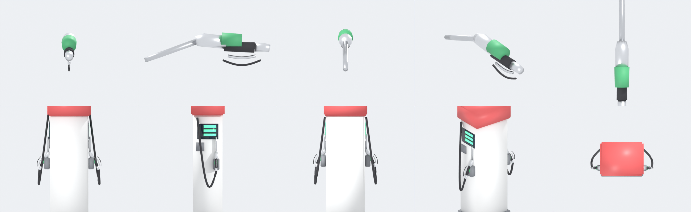

# Filling-station props (`props/fuel/`)

Modelled for Delta City in Blender by script: **CC0**, no logos or brand names. Real size in metres, +Y up.

| File | What it is | Triangles | Size | Notes |
|---|---|---|---|---|
| `fuel_nozzle.glb` | petrol nozzle: rubber grip, trigger lever and guard, aluminium body, green boot, steel spout | 632 | 16 KB | origin at the centre of the grip; spout along **+Z**, 20 degrees down; spout tip at `[0.0, -0.0502, 0.3617]`; hose end at `[0.0, -0.004, -0.13]` |
| `fuel_hose.glb` | 1 m of black fuel hose, radius 15 mm | 200 | 5 KB | origin at one end, runs along **+Z**: scale Z to length, or chain several for a sagging hose |
| `fuel_pump.glb` | two-sided dispenser: white body, red head, a screen, keypad, holster, nozzle and hanging hose on each face | 2244 | 54 KB | 0.62 x 1.79 x 0.48 m; faces **+X (side A)** and **-X (side B)**, like the pump boxes in `index.html`, so it drops into the same place |

- **Nodes in `fuel_pump.glb`:** `nozzle_A` / `nozzle_B` are the nozzles in their holsters and `hose_A` / `hose_B` their hanging hoses. Hide a side's pair while its nozzle is in an attendant's hand, and show the hand-held `fuel_nozzle.glb` instead.
- **Holster grip points** (pump space, the nozzle's origin while it hangs): side A `[0.375, 0.88, -0.12]`, side B `[-0.375, 0.88, -0.12]`. Hose outlets: A `[0.295, 1.52, 0.15]`, B `[-0.295, 1.52, 0.15]`.
- The pump stands on the island (0.18 m), so the holster grip is about 1.06 m above the road; the attendant clips reach for 1.09 to 1.12 m.
- **Price:** the screens carry plain green digit bars, not a price. Fuel is K950 per litre; the game draws the price.

The attendant clips, the nozzle's place in the hand and where to stand are in `../../animations/animations.md` ("Filling-station attendant"). Fuel caps of every car are in `../../vehicles/vehicles.md` ("Fuel caps").

