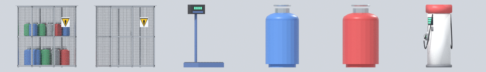

# Cooking-gas depot props (`props/gas/`)

For a cooking-gas (LPG) depot. **CC0**, no logos or brand names; real size in metres, +Y up, standing on y = 0, fronts toward +Z.

- **The cylinder** is the one from the home kitchen set (`../../home/kitchen/gas_cooker_with_cylinder.glb`, a Delta City original), lifted out, given a foot ring and set to real sizes: 12.5 kg about 0.32 m across and 0.60 m tall, 6 kg about 0.26 m across and 0.45 m tall. (The cylinder inside the home cooker model is 0.77 m tall, about a quarter too big.)
- **The cage, its sign and the scale** were modelled here. The cage door is the node `cage_door`, hinged on its left edge (its origin); turn it with `rotation.y`. The warning sign is a yellow triangle with a flame pictogram, no words.

| File | What it is | Triangles | Width x height x depth (m) | Size |
|---|---|---|---|---|
| `gas_cage.glb` | empty cylinder cage: galvanised frame, wire-mesh panels (cut-out), door, middle shelf at 0.95 m, roof, warning sign | 374 | 1.68 x 1.92 x 0.99 | 119 KB |
| `gas_cage_stocked.glb` | the cage with 8 x 12.5 kg cylinders on the floor and 10 x 6 kg on the shelf, mixed colours | 12,110 | 1.68 x 1.92 x 0.99 | 693 KB |
| `gas_cylinder_12kg_blue.glb` | 12.5 kg LPG cylinder, blue | 652 | 0.32 x 0.60 x 0.32 | 36 KB |
| `gas_cylinder_12kg_green.glb` | 12.5 kg LPG cylinder, green | 652 | 0.32 x 0.60 x 0.32 | 36 KB |
| `gas_cylinder_12kg_grey.glb` | 12.5 kg LPG cylinder, grey | 652 | 0.32 x 0.60 x 0.32 | 36 KB |
| `gas_cylinder_12kg_red.glb` | 12.5 kg LPG cylinder, red | 652 | 0.32 x 0.60 x 0.32 | 36 KB |
| `gas_cylinder_6kg_blue.glb` | 6 kg LPG cylinder, blue | 652 | 0.26 x 0.45 x 0.26 | 36 KB |
| `gas_cylinder_6kg_green.glb` | 6 kg LPG cylinder, green | 652 | 0.26 x 0.45 x 0.26 | 36 KB |
| `gas_cylinder_6kg_grey.glb` | 6 kg LPG cylinder, grey | 652 | 0.26 x 0.45 x 0.26 | 36 KB |
| `gas_cylinder_6kg_red.glb` | 6 kg LPG cylinder, red | 652 | 0.26 x 0.45 x 0.26 | 36 KB |
| `gas_scale.glb` | platform weighing scale: chequer-plate platform (top at 0.09 m), column and digital head | 168 | 0.50 x 1.06 x 0.55 | 16 KB |

